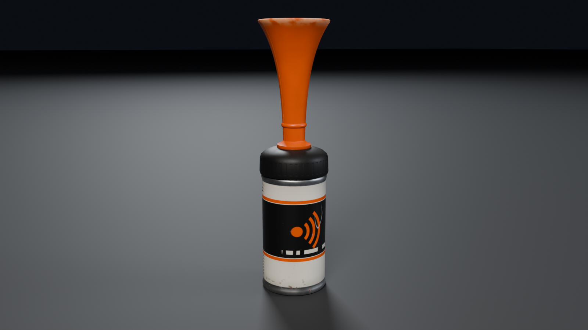
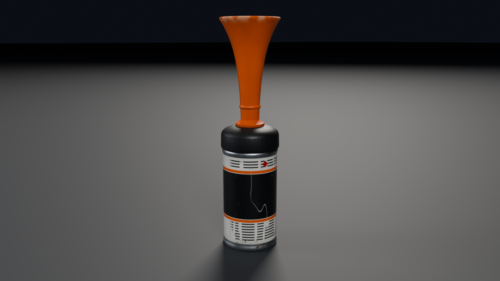
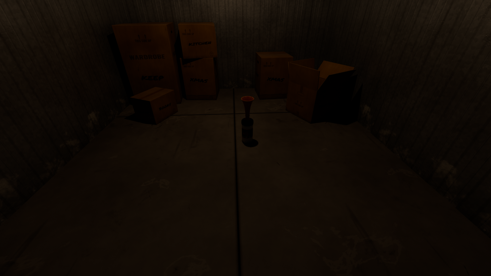
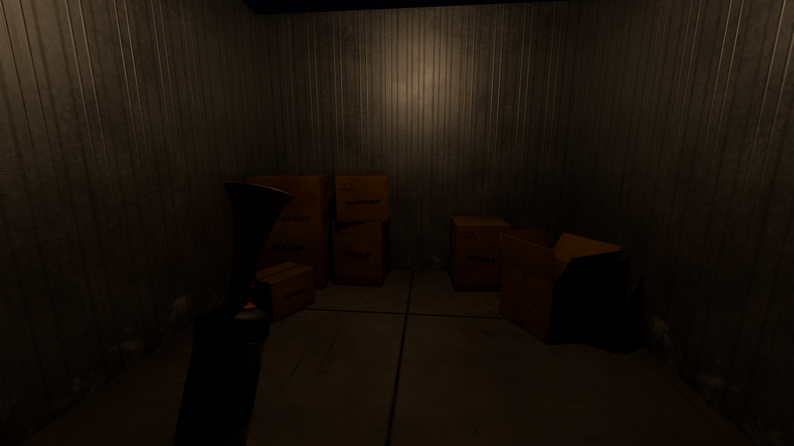

# The air horn

A marine air horn, the kind boats and stadiums use (GDD, the tools table: "Lures keepers to a
spot", and it "Wakes dormant things nearby"; Lethal Company's air horn, which draws the monsters
that hunt by sound, is where the move comes from): a steel can of compressed gas in white enamel,
a black printed band round its middle with orange stripes and an orange sound-wave mark on its
front, warnings in small black type and a red diamond on its back, chipped to grey steel and
freckled with rust round its foot, bare tinplate at the chime and the top seam; a black ribbed
collar snapped over the seam, and a safety-orange plastic trumpet standing up out of it, a
moulded ring round its neck, an exponential flare to a rolled lip, a mould seam up each side,
dark down its throat. You press the trumpet down to blow it. No brand. Built from code in Blender
5.2, the unit's way, borrowing the finds' atlas, bake and export (`art/finds/build.py`) as the
saw does.

White and orange because the torch is yellow, the cutters red and the saw green: the can is the
one white tool, and the flared trumpet is its outline from a doorway.

| | |
|---|---|
|  |  |
|  |  |

Sheets in `art/sheets/`: `airhorn-front` (the band's sound-wave mark) and `-back` (the warnings,
the trumpet's mould seam), standing on the studio floor; `-floor` (standing in a unit by its
bulb, from the doorway at standing height); `-view` (in your first-person view at the game's
hold, `Catalog.AirHorn.hold`). The two in the unit are dark because its face looks away from the
bulb; in the game your torch lights it (Studio, L-14a1).

## Numbers

Drawn in a real horn's inches (z up from the can's foot), turned round the can's axis, then
scaled by `IN` (0.15 studs to the inch, about 1.6 times life: small tools are sized up to read in
a Roblox hand, as the padlock is). It stands on its foot, the trumpet up. Its frame: the trumpet
up, the can's sound-wave mark towards the part's LookVector, every point from the grip (the can's
axis at the middle of its band, where the hand closes).

| Piece | Size (X, Y, Z) | Triangles | |
|---|---|---|---|
| AirHorn | 0.48 x 1.86 x 0.48 | 6,000 | the AirHorn texture set, 1024², 399 texels a stud |

The game reads its size, the bell's mouth and its radius, and the can's foot from
`src/shared/Tools/Specs/AirHorn.luau` (L-14a2 blows from the mouth).

## In the place

`ReplicatedStorage.Props.Tools.AirHorn` (Rojo can't sync imported meshes, D-009): uploaded by
`lune run scripts/upload_art AirHorn` (asset in `assets.json`), inserted with the MCP, its
PackageLink and `Assistant:` tag removed, then `Tools.prepare(model, "AirHorn")` in Edit (from a
fresh clone of `Shared.Tools` if the command bar has the old catalog cached, docs/STUDIO.md).

## Rebuild

```
scripts/art.sh airhorn          textures, export, renders (about 2 minutes; the floor and view
                                sheets need the boxes built)
scripts/art.sh airhorn export   just the FBX and the Specs module
```
