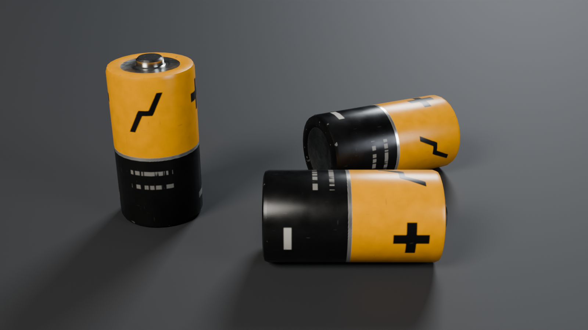
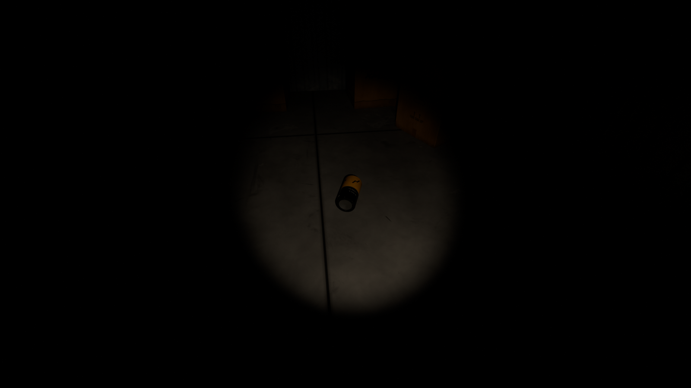

# The battery

The battery a unit can hold (GDD "Your flashlight": about one unit in ten has one; a tap fills
your flashlight at once and takes no slot). A chunky D-cell: a glossy black wrap with a bold amber
band round its top half, a big black plus on the amber twice round (one faces you however it
lies) and a zig-zag lightning bolt between them, a thin bright stripe where the amber meets the
black, a minus and rows of small grey print on the black (no real words), nickel steel ends with
the button rubbed bright, the wrap scuffed and nicked through to steel at its lips. Built from
code in Blender 5.2, the unit's way, borrowing the finds' atlas, bake and export
(`art/finds/build.py`) as the coin does.

| | |
|---|---|
|  |  |

Sheets in `art/sheets/`: `battery-studio` (one standing, two lying showing the plus and the bolt),
`battery-floor` (lying in a unit's bulb pool from the doorway at standing height), `battery-beam`
(the bulb out, only your torch on it), `battery-near` (stooping over it).

## Numbers

Sized to be seen, not to life: 0.9 studs long and 0.46 across, about four times a real D-cell, so
it reads on a unit's floor from the doorway on a phone. 896 triangles (28 round), one MeshPart,
the Battery texture set at 512² (about 345 texels a stud). Its frame: along Y, the button at +Y,
its middle the origin. The game reads its size and radius from `src/shared/Battery/Specs.luau`
and lays it on its side, a radius up, its plus facing up and rolled a little (`Batteries:lie`).

## In the place

`ReplicatedStorage.Props.Battery`, the MeshPart (Rojo can't sync imported meshes, D-009):
uploaded by `lune run scripts/upload_art Battery` (asset in `assets.json`), inserted with the MCP,
its PackageLink and `Assistant:` tags removed, the MeshPart taken out of its model, named
`Battery`, anchored (asset 81307492172647, imported Nov 14, S1-07b). Its size came in exact
(0.46 x 0.9 x 0.46), its SurfaceAppearance in AlphaMode Overlay.

## Rebuild

```
scripts/art.sh battery          textures, export, renders (about a minute; the floor sheets need
                                the boxes built)
scripts/art.sh battery export   just the FBX and the Specs module
```
