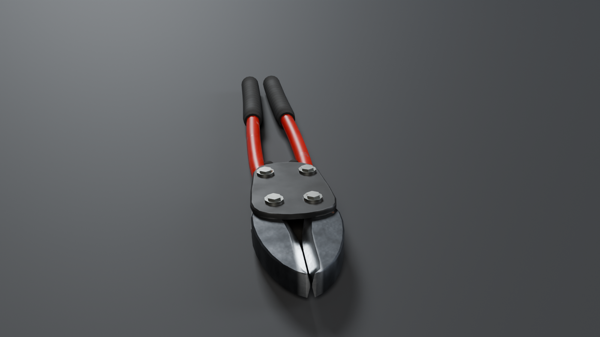
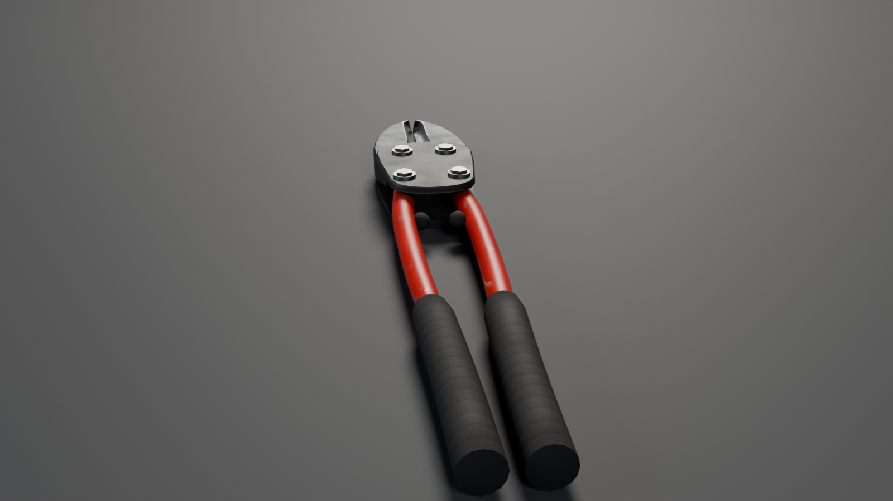
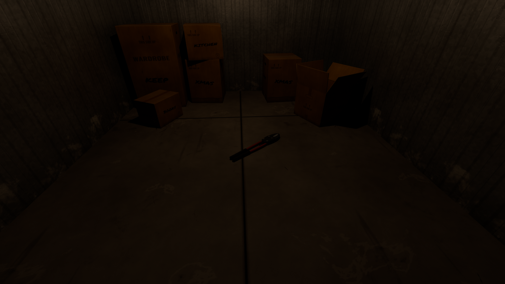
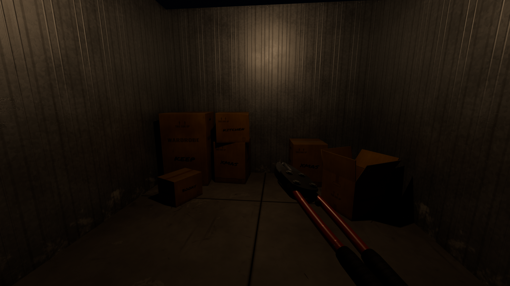

# The bolt cutters

A pair of 18-inch bolt cutters that have opened a lot of padlocks (GDD, the tools table: "Open
padlocked units and free a friend from one"): long steel handles in red enamel chipped to bare
metal, black rubber grips with moulded rings, a rubber stop between the handles behind the head,
a head of two black-painted plates bolted through with zinc hex bolts, and a short forged jaw,
dark, its double-bevelled cutting edges ground bright. Built from code in Blender 5.2, the unit's
way, borrowing the finds' atlas, bake and export (`art/finds/build.py`) as the flashlight does.

| | |
|---|---|
|  |  |
|  |  |

Sheets in `art/sheets/`: `boltcutters-front` and `-back` (lying on the studio floor), `-floor`
(on a unit's floor by its bulb, from the doorway at standing height: the moment you spot them),
`-view` (in your first-person view; the game's hold is `Catalog.BoltCutters.hold`, on the left,
since the sheet was shot on the right before the torch took that hand).

## Numbers

Sized to a Roblox hand, not to life, as the torch is: about 1.5 times a real 18-inch pair, 2.57
studs long, the head 0.38 across. The handles are drawn shut (the jaw closed), converging so one
fist closes round both grips. Its frame: the jaw towards the part's LookVector, the head's plates
up, every point from the grip (the middle of the grips, where the hand closes).

| Piece | Size (X, Y, Z) | Triangles | |
|---|---|---|---|
| BoltCutters | 0.38 x 0.20 x 2.57 | 2,564 | the BoltCutters texture set, 1024², 478 texels a stud |

The game reads its size and the jaw's tip from `src/shared/Tools/Specs/BoltCutters.luau`.

## In the place

`ReplicatedStorage.Props.Tools.BoltCutters` (Rojo can't sync imported meshes, D-009): uploaded by
`lune run scripts/upload_art BoltCutters` (asset in `assets.json`), inserted with the MCP, its
PackageLink removed, then `Tools.prepare(model, "BoltCutters")` in Edit: square to the world, the
grip at the origin and the part's pivot, nothing colliding, moved into `Props.Tools`.

## Rebuild

```
scripts/art.sh boltcutters          textures, export, renders (about a minute; the floor and view
                                    sheets need the boxes built)
scripts/art.sh boltcutters export   just the FBX and the Specs module
```
