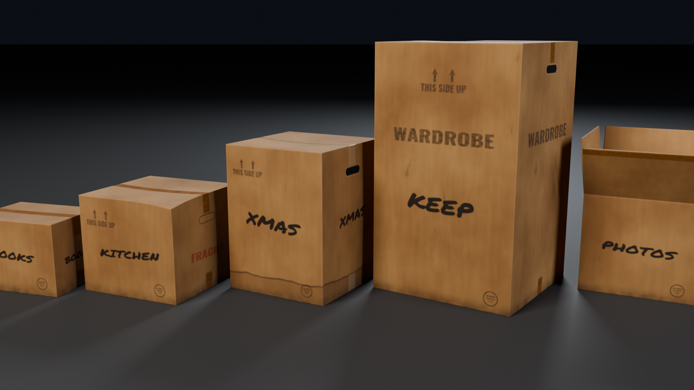
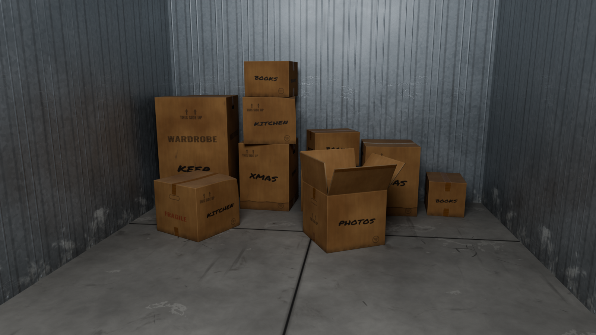
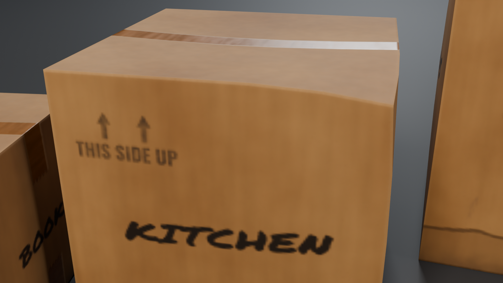
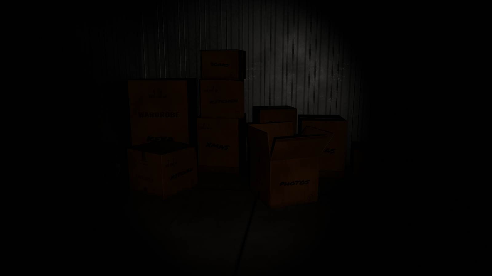
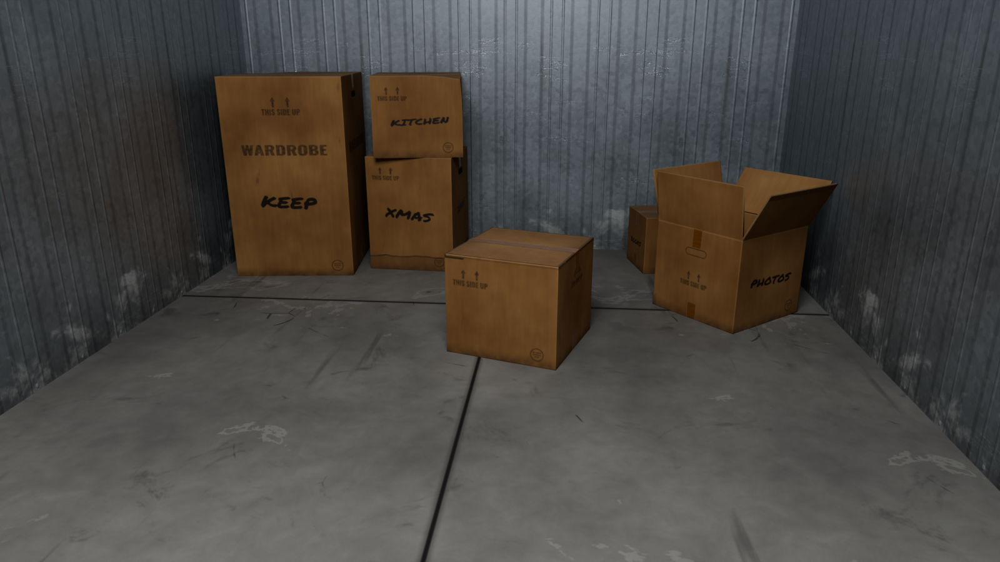
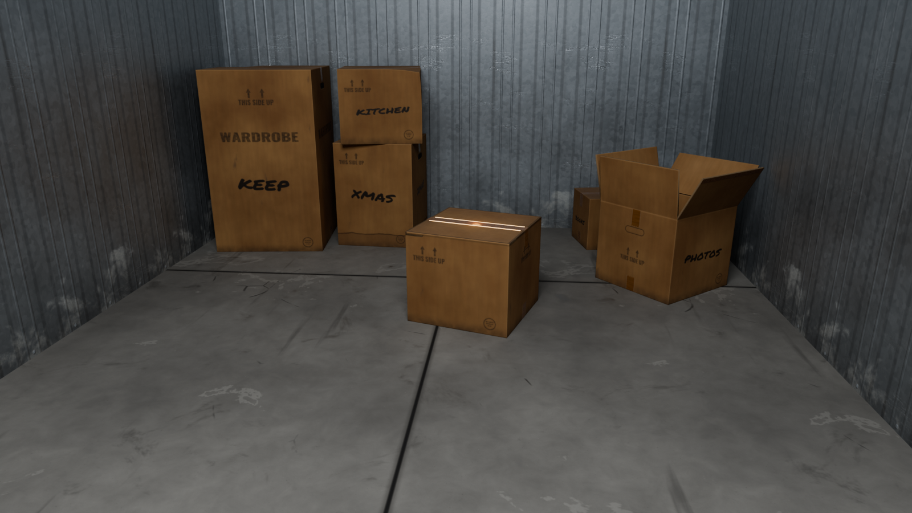
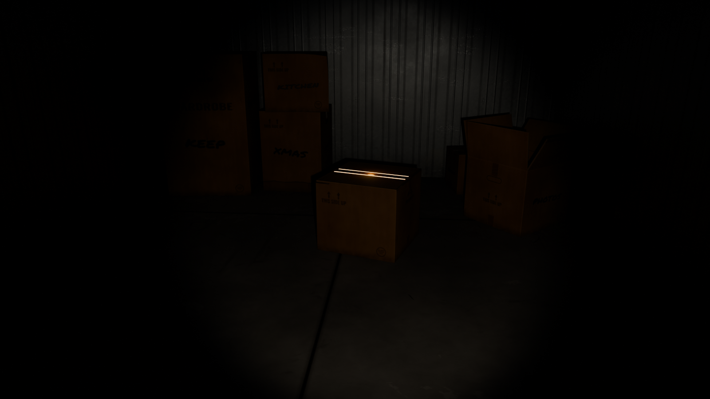
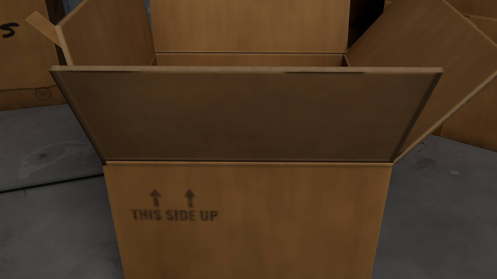

# The moving boxes

What every storage unit is full of, and the body the Stack keeper hides in (GDD keepers: "Count
the boxes"). Five boxes at real moving-box sizes, 10 inches a stud: Small (16x12x12 in), Medium
(18x18x16), Large (18x18x24), Wardrobe (24x24x40) and Open, a medium box someone already went
through, its tape slit and its four flaps up. Built from code in Blender 5.2 like the unit.

| | |
|---|---|
|  |  |
|  |  |

Sheets in `art/sheets/`: `boxes-lineup`, `boxes-close`, `boxes-unit` (stacked at the back of an
M unit, lit from the hall) and `boxes-unit-dark` (the same in a torch's beam).

## What's on them

Kraft board with fibre streaks, frayed lighter edges and grime at the base; brown packing tape (clear
on the Large, with the seam showing through) along the top seam and lapping down both ends; hand
holes on the ends (cut, or pushed in on the Large and Wardrobe); the maker's print ("THIS SIDE UP",
the ring stamp, FRAGILE in red, WARDROBE); a word in marker (BOOKS, KITCHEN, XMAS, KEEP, PHOTOS);
a crushed corner on the Medium and Wardrobe, sides bowed out by what's inside, a sagging top, a
water mark on the Large, dust on whatever faces up. The marker words and print come from a label
sheet rendered from fonts Studio ships (PermanentMarker, Oswald Bold), so a new word is one line
in `spec.py`'s `CELLS`.

## Numbers

| Box | Size (X long, Y up, Z across) | Triangles |
|---|---|---|
| Small | 1.6 x 1.2 x 1.2 | 110 |
| Medium | 1.8 x 1.6 x 1.8 | 212 |
| Large | 1.8 x 2.4 x 1.8 | 292 |
| Wardrobe | 2.4 x 4.0 x 2.4 | 554 |
| Open | 1.8 x 1.6 x 1.8 (flaps reach 2.5 up) | 740 |

Each box is one MeshPart. Its pivot is the middle of its bottom, its labelled long side faces its
front (LookVector), and the tape runs front to back over the top. One texture set, Cardboard
(1024², colour, normal and roughness; no metalness map, which Roblox reads as 0), holds every box
at 97 texels a stud: each face is packed whole into the atlas, and the side facing +Y wears the
same texels as the side facing -Y (and +X as -X, the bottom as the top), so the atlas holds half
of every box. While baking, those twin faces sit on one parked texel so only one of each pair is
painted. The game reads the sizes from `src/shared/Boxes/Specs.luau`.

## Into Studio

1. `scripts/art.sh boxes` (labels, textures, export, renders; about 2 minutes), then
   `lune run scripts/upload_art Boxes` (one FBX, one Model asset, ID in `assets.json`).
2. Insert the asset (the MCP's `insert_asset`), then in the Edit view, with Rojo synced:
   ```lua
   local Boxes = require(game.ReplicatedStorage.Shared.Boxes)
   local folder = game.ReplicatedStorage.Props.Boxes -- make the two Folders the first time
   for _, p in workspace.Boxes:GetChildren() do
       if p:IsA("MeshPart") then
           Boxes.prepare(p, p.Name); p:PivotTo(CFrame.new()); p.Parent = folder
       end
   end
   workspace.Boxes:Destroy()
   ```
   Remove the `Assistant:` tag `insert_asset` adds. `prepare` anchors the box, turns off touches,
   squares its pivot and sets its collision to its box (the Open one's hull); from the MCP that
   last write doesn't take, so set CollisionFidelity in the Properties panel (`docs/STUDIO.md`).
3. Save the place: the templates live in it at `ReplicatedStorage.Props.Boxes.<Name>` (D-009).

`Boxes.clone(name, pivot, parent)` stands a copy anywhere; L-04d's director will stack them.

## How it's made

```
art/boxes/spec.py    every number: sizes, tape, holes, dents, stains, what's printed and written
art/boxes/build.py   stages labels | textures | export | renders; the faces, the atlas packer, the
                     cardboard recipe (object-space studs plus each face's own studs)
```

It borrows the unit's helpers (`art/unit/bake.py`, `nodes.py`, `geo.py`, `render.py`) and its
Partition and Concrete textures for the look sheets' room.

## The marked box (B-01a, D-208)

The one box in a unit with something in it: a Medium box with the maker's print and nothing
written on it, fresh tape whole along the seam. It rides in `Boxes.fbx` as eight parts named
`Marked_<Part>`: Body, FlapFront, FlapBack, FlapLeft and FlapRight (the end flaps, under the long
ones), TapeLeft and TapeRight (each hinged where it laps down an end) and Seam (two thin lines
along the tape's edges, untextured: the game makes them Neon). `spec.py` holds its hinges
(`MARKED_PARTS`), the Open motion's keys (`OPEN`) and the cue (`CUE`); the export writes them into
`Specs.Marked` in Roblox axes. `scripts/art.sh boxes marked` renders its sheets:

| | |
|---|---|
|  |  |
|  |  |

`boxes-marked-dark` and `-close-cue` too, and `boxes-marked-open-strip` (the opening in ten
frames; `out/marked-open.mp4` plays it at 30 a second). For the bake the end
flaps stand open and the tape floats clear, so neither bakes the other's shadow.

