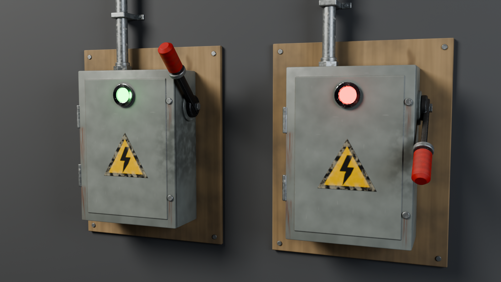
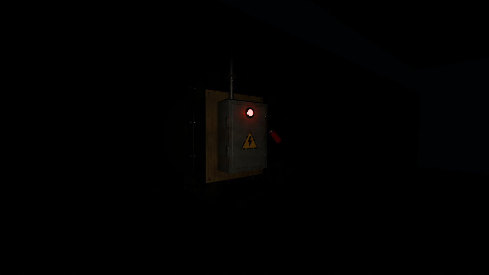

# The breaker box

The box that holds a floor's power (GDD "The breaker"; as Phasmophobia's fuse box, which the
ghost switches off and the team goes to switch back on). A heavy-duty safety switch in a back
hall: a deep grey enamel box chipped to red primer and steel, rust weeping from its hinges and
screws, on a raw plywood board; a pilot lamp in a chrome bezel at the top of its door, a yellow
sticker with a black lightning bolt, a galvanized conduit climbing from its top to the wall's cap
and turning into the wall; and on its right side the lever: a black steel arm on a round boss with
a ribbed safety-red grip. Lever up is on, down is off. Built from code in Blender 5.2, the unit's
way, borrowing the finds' atlas, bake and export (`art/finds/build.py`) as the machine does.

| | |
|---|---|
|  |  |

Sheets in `art/sheets/`: `breaker-studio` (on beside off), `breaker-side` (the lever from the
side), `breaker-dark` (the power cut, only a torch from across the hall, a phone's view),
`breaker-far` (down the hall, no torch: only the lamp), `breaker-on` (switched back on, a hall
light over it).

## Numbers

About one and a half times a real one, so it reads across an 8-stud hall on a phone: the box 2
across, 2.8 tall, 0.86 deep with its door, its middle 4.45 up (just under your eyes); the board 3
by 3.7; the conduit up to 9.6, under the wall's cap. The lever swings 42 degrees above and below
level, pointing at the hall, its grip 0.26 thick and 0.62 long. Three MeshParts: `Breaker`
(2,273 triangles: board, box, door, conduit), `BreakerLever` (660) and `BreakerLamp` (216,
untextured: the game lights it). One texture set, Breaker, at 1024 (134 texels a stud).

Its frame: the origin on the floor on the wall's face, under the board's middle; its front
toward its LookVector. The game reads every number from `src/shared/Breaker/Specs.luau`: the
lever's pivot, its up and down angles, the grip's middle at each, the lamp.

## In the place

`ReplicatedStorage.Props.Breaker`, a Model (Rojo can't sync imported meshes, D-009): uploaded by
`lune run scripts/upload_art Breaker` (asset in `assets.json`), loaded with
`InsertService:LoadAsset` from an Edit execute, its PackageLink and `Assistant:` tags removed.
Every part anchored, CanTouch off, CollisionFidelity Box; the lever and the lamp don't collide,
the lamp casts no shadow. Each part's pivot is the breaker's origin (the lever's its pivot), with
no turn: the box arrived with a pivot turned 90 degrees about X, like the unit's. PrimaryPart is
the box; the lever stands up (on). Imported Nov 14, S2-02a.

## Rebuild

```
scripts/art.sh breaker          textures, export, renders (about 3 minutes)
scripts/art.sh breaker export   just the FBX and the Specs module
```
