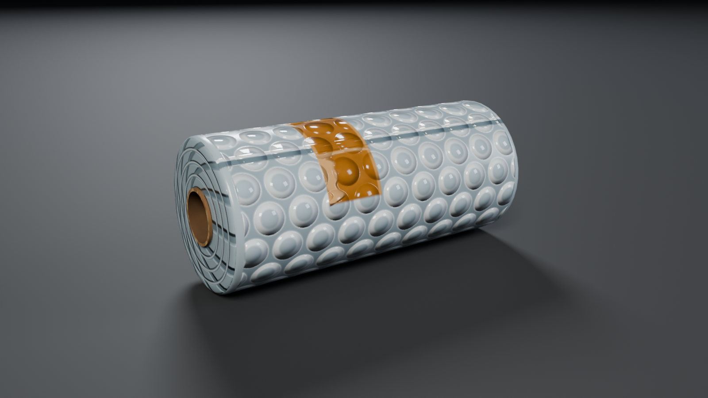
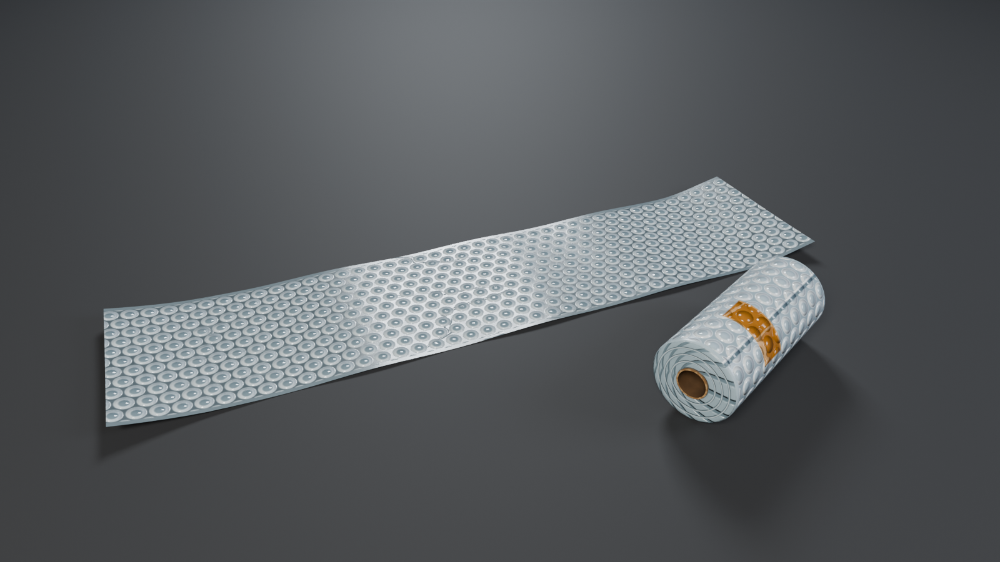
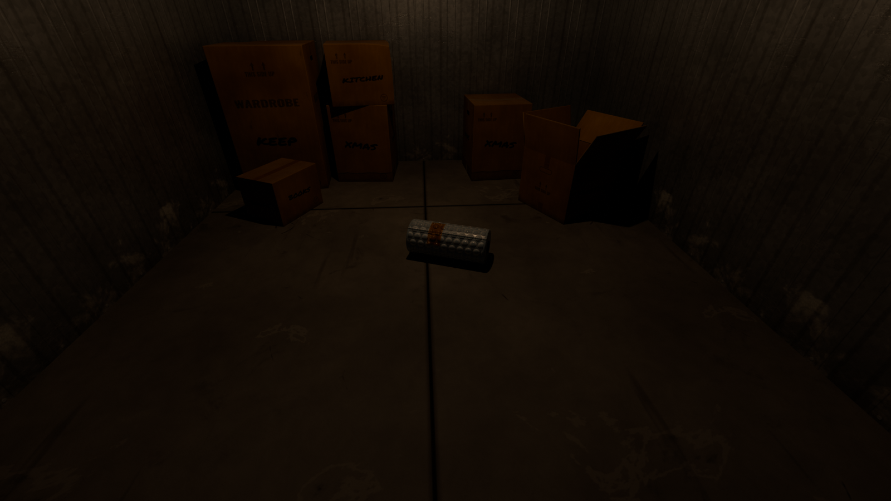
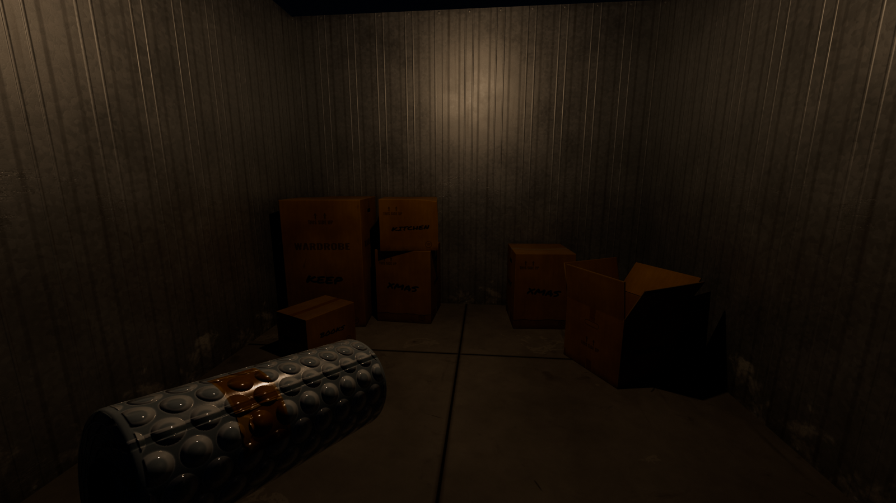

# Bubble wrap

A roll of large-bubble wrap on a cardboard core, its loose end taped down, and the same wrap
unrolled flat across a hall (GDD, the tools table: "Laid across a hall, it pops when anything
crosses", and "Friends pop it too"; an alarm you set behind you, as Minecraft's tripwire is set off
by any mob or player that walks through it). Clear plastic with a cool tint, milky where it's
wound thick, bubbles a fat inch across in staggered rows; brown packing tape across the seam; the
core's brown tube standing a little proud of each wound end, so it reads as a roll from any side.
Built from code in Blender 5.2, the unit's way, borrowing the finds' bake and export
(`art/finds/build.py`) as the air horn does, with its own atlas layout.

| | |
|---|---|
|  |  |
|  |  |

Sheets in `art/sheets/`: `bubblewrap-roll` (an end's wound layers and core, the taped seam) and
`-sheet` (the sheet laid flat from standing height, the roll beside it for size), on the studio
floor; `-floor` (on its side in a unit by its bulb, from the doorway at standing height); `-view`
(in your first-person view at the game's hold, `Catalog.BubbleWrap.hold`). The two in the unit
are dark: in the game your torch and the hall's light find it (Studio, L-14b1).

## Numbers

Drawn in a real roll's inches, scaled by `IN` (0.15 studs to the inch, about 1.6 times life, as
the air horn is). The roll's frame: its axis along X, up Z, the taped end high on its front (-Y,
the part's LookVector in Roblox), every point from the grip, the middle of its axis. The sheet's:
across the hall along X, along the hall Y, from the middle of the floor under it.

| Piece | Size (X, Y, Z) | Triangles | |
|---|---|---|---|
| BubbleWrap (the roll) | 1.8 x 0.78 x 0.78 | 1,840 | the BubbleWrap set, 1024², 240 texels a stud |
| BubbleSheet (laid) | 7.35 x 0.17 x 1.8 | 768 | the same set, 137 texels a stud |

The atlas is laid out by hand: the sheet a strip along the bottom, square texels, and the roll
smart-projected into the square above it. The game reads the roll's box and radius and the
sheet's box from `src/shared/Tools/Specs/BubbleWrap.luau`.

## In the place

`ReplicatedStorage.Props.Tools.BubbleWrap` (the roll) and `ReplicatedStorage.Props.BubbleSheet`
(the sheet, a Model with its MeshPart as PrimaryPart, pivot at the middle of the floor under it:
anchored, no collision, touch, queries or shadow). Rojo can't sync imported meshes (D-009):
uploaded by `lune run scripts/upload_art BubbleWrap` (asset in `assets.json`), inserted with the
MCP, its PackageLink and `Assistant:` tag removed; the sheet moved out to `Props.BubbleSheet` and
placed by `Specs.Sheet.Centre`; then `Tools.prepare(model, "BubbleWrap")` in Edit (from a fresh
clone of `Shared.Tools` if the command bar has the old catalog cached, docs/STUDIO.md).

## Rebuild

```
scripts/art.sh bubblewrap          textures, export, renders (about 3 minutes; the floor and view
                                   sheets need the boxes built)
scripts/art.sh bubblewrap export   just the FBX and the Specs module
```
