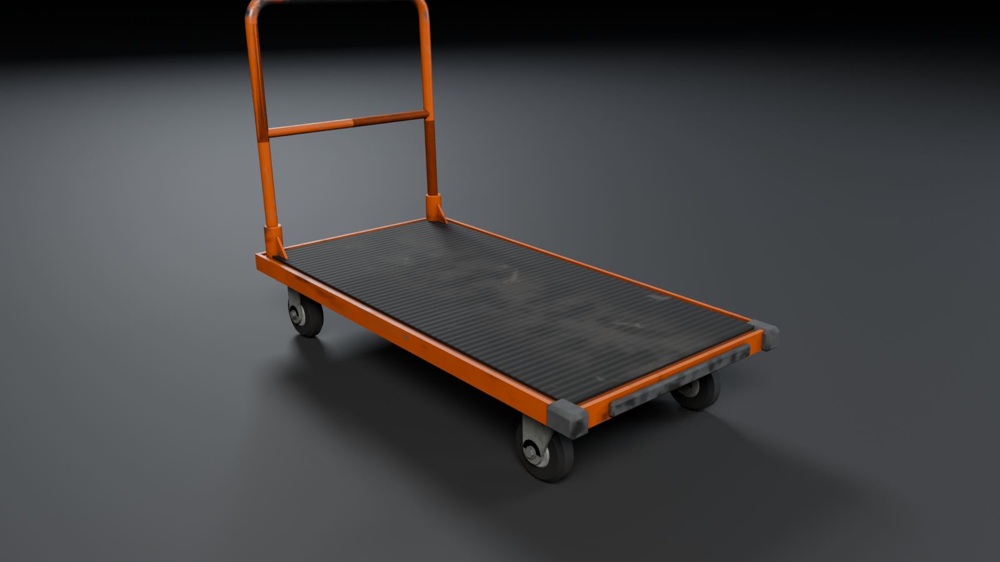
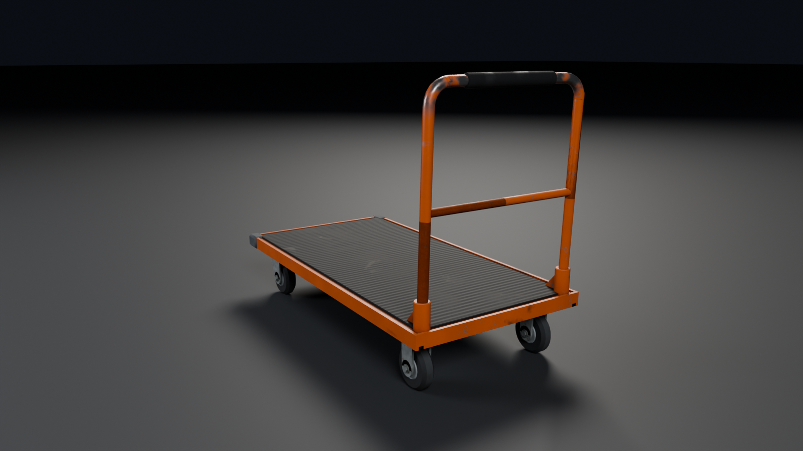
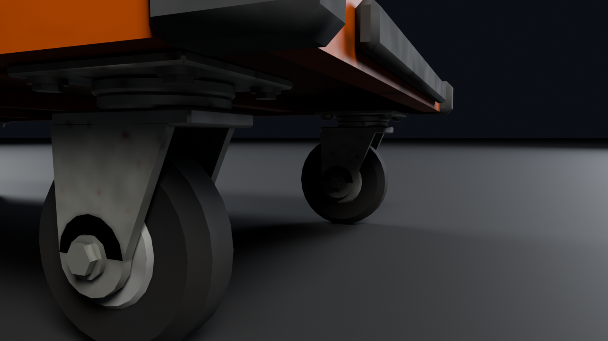
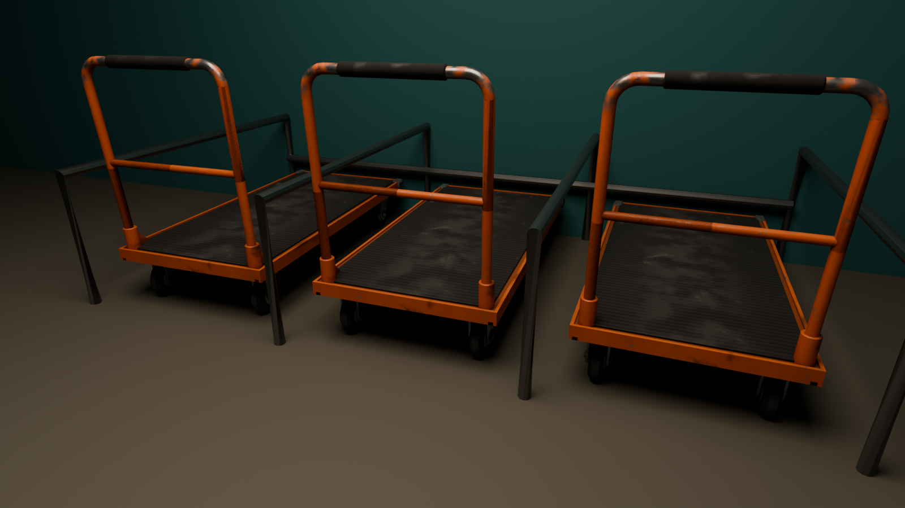

# The platform cart

The front office's platform cart (GDD "The lobby", the cart ride; ROADMAP L-08e4): the kind every
self-storage office leaves by the door for moving day. A welded steel deck in worn safety-orange
powder coat with a ribbed black rubber mat, a U-shaped push handle at the back with a cross bar and
a black foam grip, grey rubber bumpers on the front corners and across the nose, and four 6-inch
casters: the front pair swivel, the back pair are fixed. Chipped to grey steel on the edges that
knock door frames, scuffed black on the sides, the mat worn grey down the middle where feet go.
No brand. Built from code in Blender 5.2, the unit's way, borrowing the finds' atlas, bake and
export (`art/finds/build.py`) as the ladder does.

Orange so it reads against the lobby's teal walls from the spawn on a phone, and because it's the
colour of the thing you grab and go with.

| | |
|---|---|
|  |  |
|  |  |

Sheets in `art/sheets/`: `cart-hero` (three-quarter from the nose), `-back` (from behind, the
handle and grip), `-caster` (a front swivel caster up close), `-rack` (three in a rack sized as
the front office's, from the room) and `-rack-phone` (the same from farther, at 844 by 390). In the
game: `docs/art/L-08e4a-spawn.jpg` (from the spawn) and `docs/art/L-08e4a-rack.jpg` (up close),
Studio Play.

## Numbers

Drawn in studs at the building's scale (a stud is about a foot). The deck is 2.2 by 4.3, as the
rack's slots were sized for (`art/lobby/spec.py`, `RACK_*`: a hoop every 3 studs, 4.7 deep), so
the whole cart, 2.25 by 4.39 with its bumpers, parks nose-in between two hoops. The mat's top is
0.8 up (a step), the handle's top bar 3.15. The cart's frame: the nose towards the part's
LookVector, the handle behind, the pivot on the floor under the deck's middle.

| Piece | Size (X, Y, Z) | Triangles | |
|---|---|---|---|
| Cart (the body) | 2.25 x 3.06 x 4.39 | 3,680 | deck, mat, handle, grip, bumpers, plates, back forks |
| CartForkL, CartForkR | 0.30 x 0.43 x 0.36 | 476 each | the front swivel forks, each turning about its kingpin |
| CartWheelFL, FR, BL, BR | 0.20 x 0.50 x 0.50 | 516 each | the wheels, each spinning about its axle (its middle) |
| | | | one Cart texture set, 1024², 94 texels a stud |

Left and right are as you push it from the handle. The game reads every part's box, the casters'
kingpins and axles, the deck and the handle from `src/shared/Cart/Specs.luau`. A front wheel
trails 0.11 behind its kingpin, towards the handle, as a pushed cart's do.

## In the place

`ReplicatedStorage.Props.Cart` (Rojo can't sync imported meshes, D-009): uploaded by
`lune run scripts/upload_art Cart` (asset in `assets.json`), inserted with the MCP, its
`Assistant:` tag removed, then `Cart.prepare(model)` in Edit (require a clone of
`ReplicatedStorage.Shared`, STUDIO.md): the PackageLink gone, squared at the origin, every part
anchored and out of physics, an invisible `Deck` box from the floor to the mat's top to bump and
step on, the body the PrimaryPart with its pivot on the floor, streamed whole. `Lobby.lay` parks
one at each of the rack's slots (`Cart.park`), each a degree or two off square and its front
casters turned every which way (`Lobby.Parked`).

## Rebuild

```
scripts/art.sh cart            textures, export, renders (about two minutes)
scripts/art.sh cart export     just the FBX and Specs module
```

After a rebuild that changes the FBX: `lune run scripts/upload_art Cart` updates the asset in
place; insert it again and run `Cart.prepare` on it in place of the old template.
