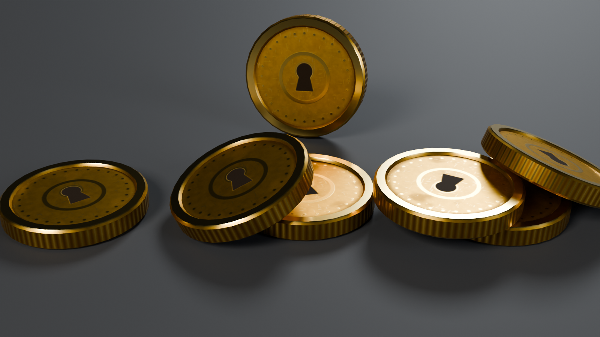
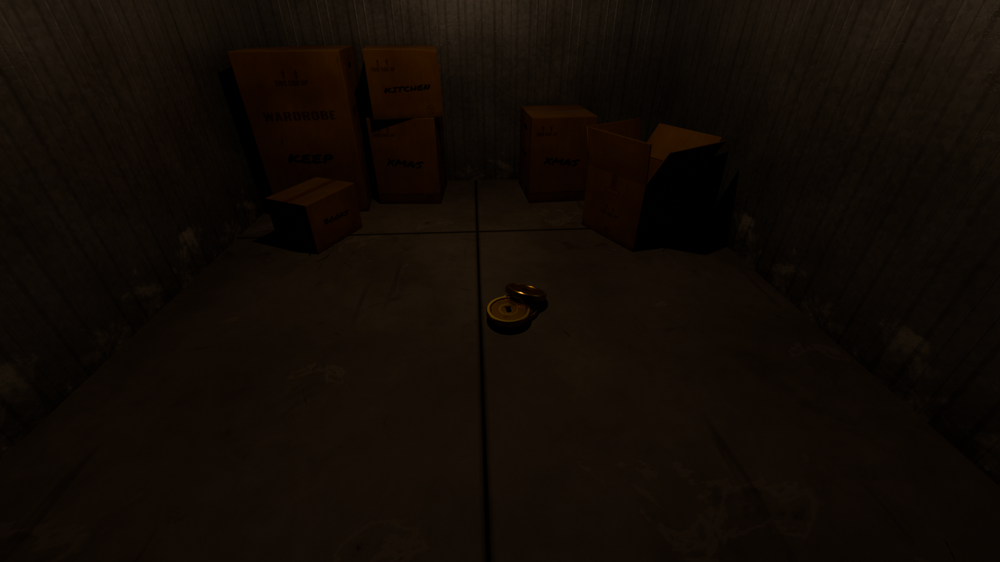

# The coin

The coin a door pays out (GDD "Doors": about seven units in ten have one to three coins lying on
the floor). A chunky old gold coin, worn: a raised rim with a ring of beads inside it, a keyhole
stamped through the middle of both faces (the building's own coin, for the machine on the ride),
a reeded edge, tarnish in the low places and the high places rubbed bright. Built from code in
Blender 5.2, the unit's way, borrowing the finds' atlas, bake and export (`art/finds/build.py`)
as the padlock does.

| | |
|---|---|
|  |  |

Sheets in `art/sheets/`: `coin-studio` (the piles of one, two and three, and a coin on its edge),
`coin-floor` (a pile of three in a unit's bulb pool, from the doorway at standing height: the
moment the door goes up), `coin-near` (stooping over it).

## Numbers

Sized to be seen, not to life: 0.8 studs across and 0.12 thick, about three times a real coin,
so a pile reads on a unit's floor from the doorway on a phone. 512 triangles (32 round), one
MeshPart, the Coin texture set at 512² (about 300 texels a stud).

A pile is copies of the one coin, laid out by `spec.py` (`piles`): one lying flat; two, one
leaning on the other; three, one flat, one lying on it slid off its middle, one leaning on the
first from the other side. The lean is worked out from the coin's size so coins touch and never
sink into each other or the floor. The game reads the coin's size and each pile's coins (a middle
and a turn from the pile's middle on the floor) from `src/shared/Coins/Specs.luau`.

## In the place

`ReplicatedStorage.Props.Coin`, the MeshPart (Rojo can't sync imported meshes, D-009): uploaded
by `lune run scripts/upload_art Coin` (asset in `assets.json`), inserted with the MCP, its
PackageLink and `Assistant:` tag removed, the MeshPart taken out of its model, named `Coin`,
anchored (asset 88101556754832, imported Nov 14, S1-04a2). Its size came in exact (0.8 x 0.12 x
0.8), its SurfaceAppearance in AlphaMode Overlay; the server sets each clone's collision, query
and shadow off, and the client's count and flying coins show it in a ViewportFrame.

## The count's icon

`--stage icon` renders the coin face on, turned 22 degrees and tilted 8 (as the count showed the
3D coin), lit by the studio rig's lights with no sweep, on a clear background, 256 px square:
`out/CoinIcon.png`. A picture rather than a ViewportFrame so it's as sharp as the number beside
it (D-158). Uploaded through the Studio MCP's `upload_image` (docs/STUDIO.md, "A 2D picture from
the Studio MCP"); the ID is `Icon` in `assets.json` and `Coins.Icon` in the game. A changed
render needs a new upload and both IDs changed.

## Rebuild

```
scripts/art.sh coin          textures, export, renders (about a minute; the floor sheet needs
                             the boxes built)
scripts/art.sh coin export   just the FBX and the Specs module
```
