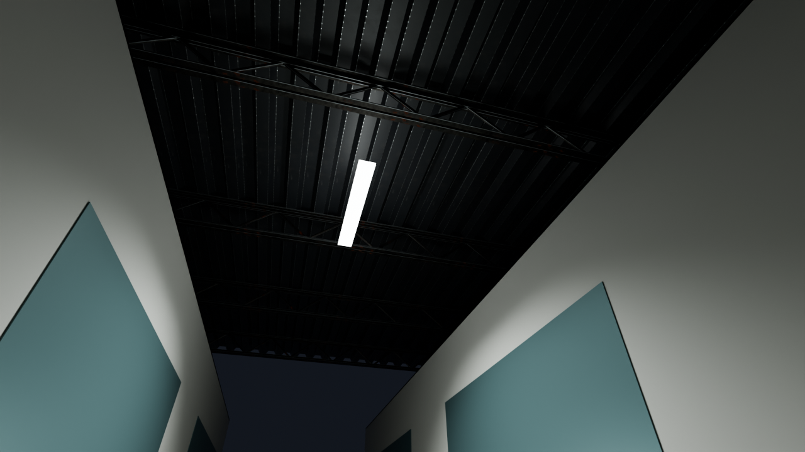
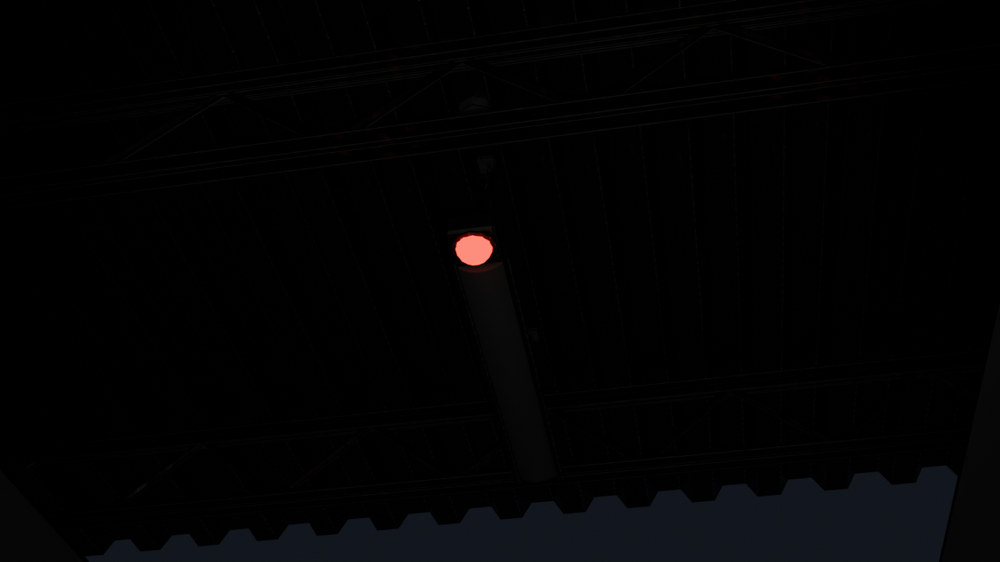
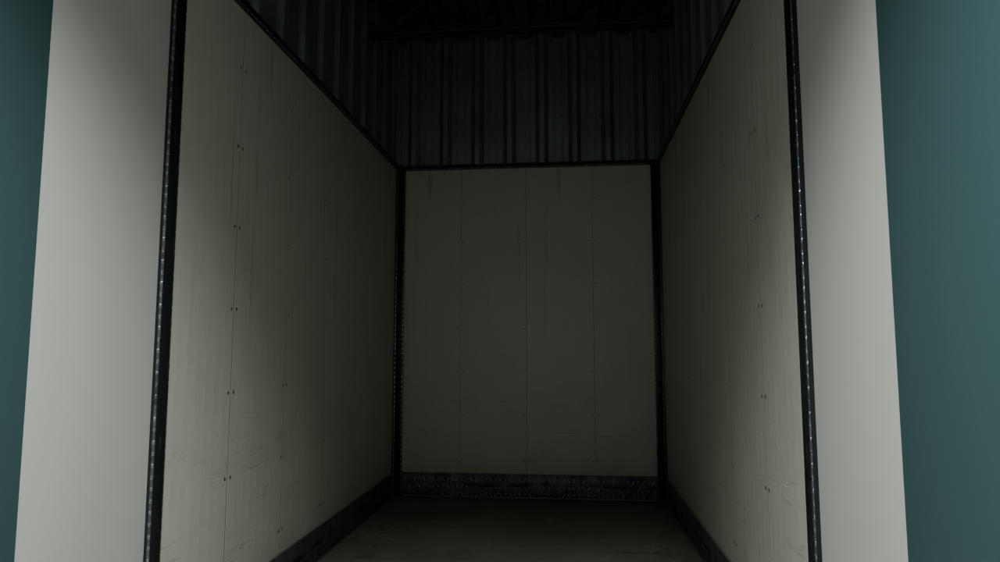
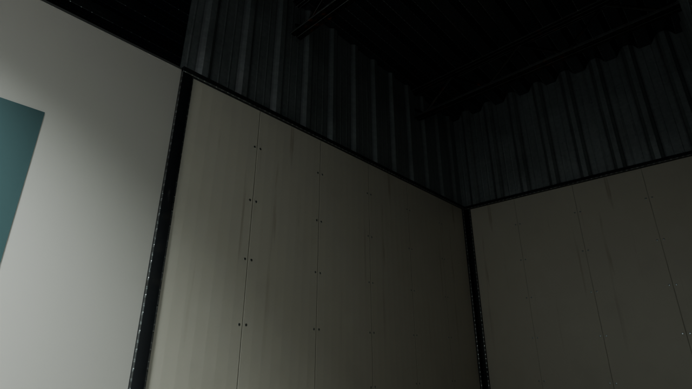
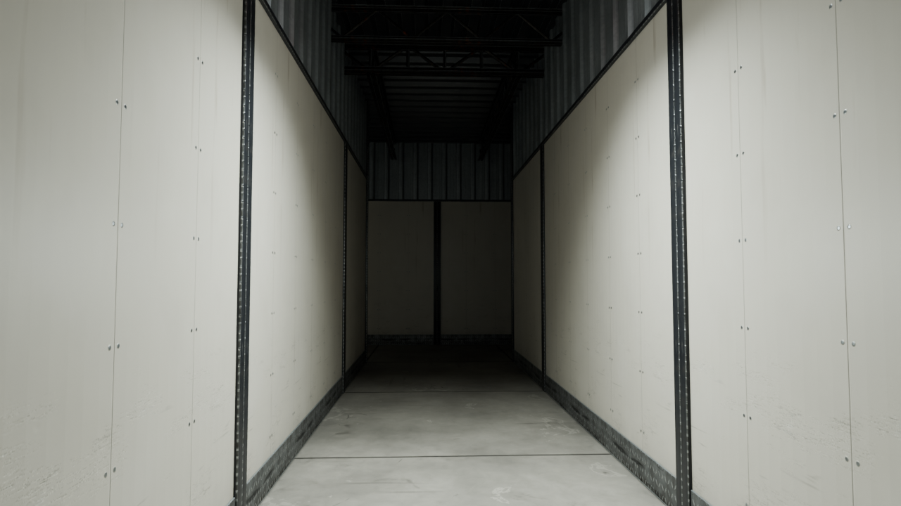
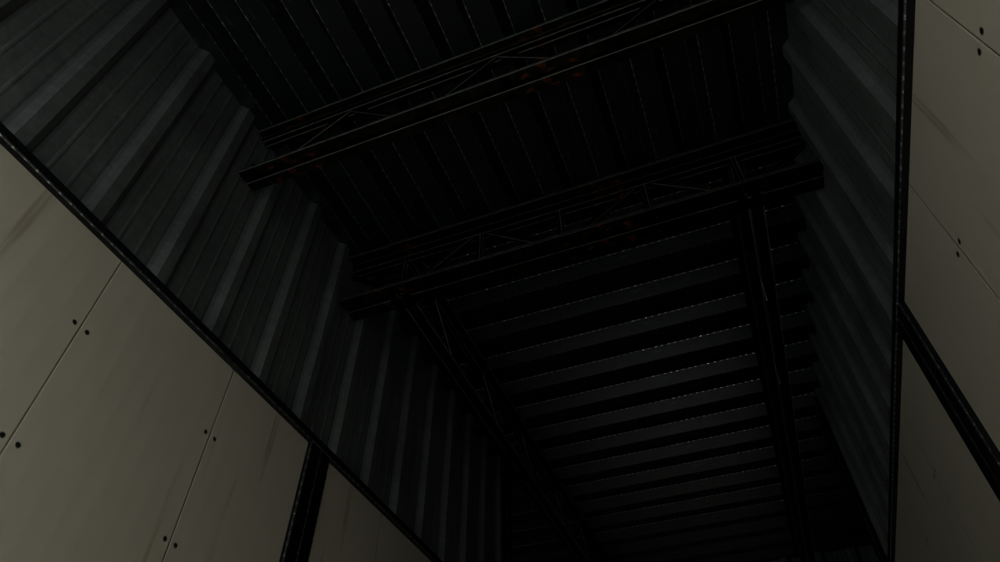
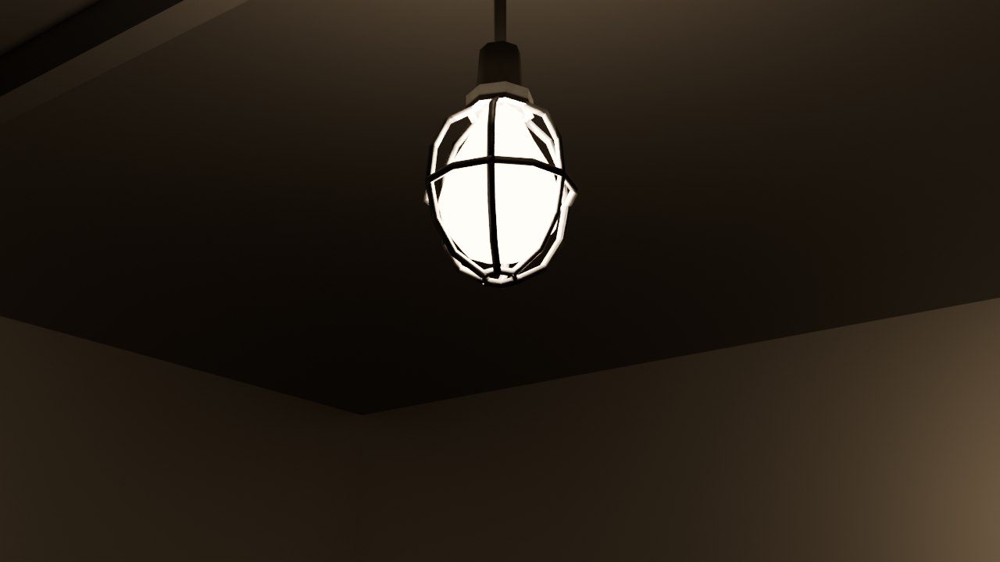
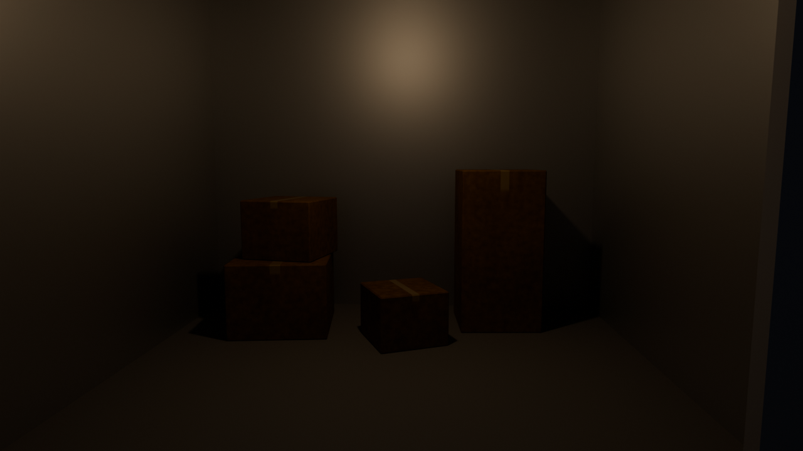

# The corridor kit

The building's hall, as pieces a floor is laid from (the GDD's tile set: straight, corner, T,
cross, dead end). Built from code in Blender 5.2, the way the unit is (`art/unit/README.md`), and
wearing the unit's own baked texture sets, so the kit bakes nothing.

| | |
|---|---|
|  |  |
|  |  |
|  |  |
|  |  |
|  |  |

Sheets in `art/sheets/`: `corridor-hall` (a player's eyes down two pieces to the dead end),
`corridor-ceiling` (looking up under a light), `corridor-seam` (straight down on the joint between
two pieces), `corridor-fixture-lit` (walking up to a lit fixture, its eye flared),
`corridor-fixture` (a torch up at a dark one, its eye watching), `corridor-deadend` (the hall that
stops, plain walls either side) and `corridor-wall` (across the hall at a plain wall, up to the
deck); `corridor-turn` (down a hall to a T), `corridor-girder` (up at the girder over the T's
stub) and `corridor-corner` (up a turned arm to a corner); `corridor-bulb` (up at a unit's lit
bulb) and `corridor-bulb-unit` (into a stand-in unit by its bulb alone, `--stage bulb`). The units there are plain stand-in boxes; the light a lit fixture throws is render
dressing. In-game shots are in `docs/art/P0-03a-*.jpg`, `P0-03b-phone.jpg`, `P0-03c-*.jpg` and
`P0-03d-*.jpg`; the bulb's in `L-04b-*.jpg`.

## Built so far

**Straight** (P0-03a): 24 studs of hall, the length of two M units a side (three S) and one hall
light's stretch. Two MeshParts:

| Part | Set | Tris | What it is |
|---|---|---|---|
| Floor | Concrete | 12 | the hall's slab between the two rows of door faces, top at 0 |
| Ceiling | TrimSheet | 1700 | a corrugated steel deck (painted strip) over the hall and the units either side, on four open-web steel joists (raw-steel strip) |

A hall of straight pieces draws in two calls: Roblox instances identical meshes.

**Fixture** (P0-03b, D-021): the hall light, the building's eye. A steel strip light hung on two
jack chains from the deck, with an occupancy sensor on one end. Three MeshParts:

| Part | Set | Tris | What it is |
|---|---|---|---|
| Housing | TrimSheet | 1836 | the painted channel and sensor box, galvanized chains, deck clips and junction box, a black rubber cord |
| Diffuser | none | 40 | the frosted lens, bowed down; the game lights it (`HallLight.light`) |
| Eye | none | 118 | the sensor's faceted half-sphere dome; the game colours it (`HallLight.eye`) |

The lens's middle and size are read from the game's `HallLight.Height` and `TubeSize`, so it sits
exactly where the light was tuned. Its frame is on the floor under the lens's middle, the sensor
towards +X. It belongs midway between two joists (every 6 studs from 3 off a piece's middle); it
reaches 2.45 along the hall each way at most, clear of the joists' steel at 2.81.

**The hall's walls** (P0-03c, D-022): a unit's front without the door, so the hall reads as one
building. The **plain wall** (`Wall`) stands where no unit does, one M unit wide (12), on the door
faces' line; the **dead end** (`DeadEnd`) crosses the hall's end and closes the deck over the whole
span (32). Below the units' wall height (10) each is the unit's corridor wall: painted panels
between posts, a diamond kick plate, the cap; above it an R-panel rises to the deck, where a unit
is open over its steel top. Three MeshParts each:

| Part | Set | Tris (Wall / DeadEnd) | What it is |
|---|---|---|---|
| Facade | Facade | 2 / 2 | the painted panels, flat on the face; the game paints it per floor |
| Trim | TrimSheet | 304 / 304 | half posts at each end, the kick plate, the cap |
| Panel | Partition | 250 / 652 | the R-panel from the cap up through the deck; bare sheets behind |

A wall's frame is the middle of its hall face, on the floor, looking into the hall: a unit's door
face, so a plain wall goes wherever a unit would. On the plain wall the panel's ribs sit just
behind the cap, under the deck's low flute that runs over the hall's side, and the joists pass
through it. On the dead end the panel's valleys are flush with the deck's end, so no gap opens
between them; its cap stands out further (0.12) to cover the ribs. Beside the hall, behind the
unit rows' end walls, the dead end has a bare sheet, so a slot that ends there is closed.

**The junctions** (P0-03d, D-023): the corner, the T and the cross, where halls meet. Each is a
24-stud square on the straights' grid; the game turns one to fit (`CorridorKit.junction`), so one of
each serves every turn. Three MeshParts:

| Part | Set | Tris (Corner / T / Cross) | What it is |
|---|---|---|---|
| Floor | Concrete | 12 | the whole square, mapped like a straight's, so each arm meets it on a joint |
| Ceiling | TrimSheet | 2316 / 1932 / 2260 | the deck along X, joists along Z on the 6-stud beat, a joist girder across each Z arm's mouth where the deck turns (a closure plate on top); to the span's edge on a closed side |
| Trim | TrimSheet | 216 / 216 / 432 | a steel column from the floor to the deck at each corner where its walls meet |

A straight's deck runs along its own hall, so a turned straight wears a turned deck; the girder
hides where it meets the junction's. The walls are the kit's own, which `junction` stands where
the spec lists them: short walls round each block of wall between two halls and along a corner's
outer sides, two plain walls across a T's stub. **The short wall** (`ShortWall`) is the plain wall
an S unit wide (8): Facade 2, Trim 304, Panel 170 tris.

A junction's frame is the middle of its square, on the floor, its deck along X; its arms
(`Specs.Junctions.<name>.Arms`) are in that frame: the corner's +X and +Z, the T's +X, -X and +Z
(the stub), the cross's all four.

**Bulb** (L-04b, D-034): the unit's own light, a caged bulb on a short cord hung under the middle
of a unit's steel top, from the underside of its middle channel (its frame, 9.78 up). Cage
(TrimSheet: a galvanized cord grip and guard, a black cord and bakelite socket), 408 tris; Glass,
a plain part `UnitLight` lights, 110 tris. Round about its cord, so the importer's turn never shows.
The glass's middle is 1.11 below the hang point (8.67 over the floor), clear of any head.

## Numbers (studs; `spec.py` holds them all)

| | |
|---|---|
| Frame | origin at the middle of the hall floor, on the floor; the hall runs along X |
| Hall | 8 wide, door face to door face |
| Ceiling | 32 across (the hall and a 12-deep row of units each side); deck underside 14, closed top 14.35 |
| Joists | every 6, half a spacing in from each end; lowest steel at 12.8 |
| Floor texture | repeats every 8 with a saw-cut joint on its edge; a piece's UVs start on that edge |
| Fixture | lens middle 12.1 (3.8 by 0.44), housing top 12.38, eye 0.36 across hanging to 11.91, chains 1.5 either side of the middle |
| Junctions | 24 square; girder chords 0.24 legs, web a vertical every 1.5; corner columns 0.09 proud outside, 0.15 inside |
| Walls | the unit's: cap at 10 (underside 9.88, 0.08 proud), posts 0.25 and 0.07 proud, kick plate 0.7; panel to the deck's top 14.35; collider 1 deep behind the face, to 14.35 |

Why these: pieces are a multiple of 8 long, so two pieces meet on a joint and never show a seam,
and a multiple of 6, so the joists keep their beat across pieces. The haze under a lit tube
reaches 12.6 (`HallLight.HazeHeight` 9.6 plus a puff's 3), and low graphics draws a hard line
where a puff cuts into anything, so the joists stop at 12.8. `tests/corridor.spec.luau` holds
those rules against the game's numbers, and the export refuses to build if the haze would reach
the joists.

## Into Studio

1. **Build and upload:** `scripts/art.sh corridor` (under a minute), then
   `lune run scripts/upload_art` (or `upload_art Corner T` for some). Each piece and the fixture
   is its own FBX, `out/Corridor_<Name>.fbx`, and its own Model asset, recorded in `assets.json`.
   Blender stamps the export time into the FBX, so a rebuild always uploads again (in place, same
   ID).
2. **Insert and prepare** (through Studio's MCP or the command bar), with Rojo synced:
   ```lua
   -- insert_asset(<id from assets.json>) into Workspace, then:
   -- a Clone: in Edit, require keeps the first version it loaded (docs/STUDIO.md)
   local CorridorKit = require(game.ReplicatedStorage.Shared.CorridorKit:Clone())
   local m = workspace.Corridor_Straight -- or _Corner, _T, _Cross, _Wall, _ShortWall, _DeadEnd,
   -- _Fixture, prepared by that name
   m:FindFirstChildOfClass("PackageLink"):Destroy() -- a plain model, not a package
   -- remove the insert's "Assistant:<guid>" tag too
   CorridorKit.prepare(m, "Straight")
   m:PivotTo(CFrame.identity)
   m.Name = "Straight"; m.Parent = game.ReplicatedStorage.Corridor -- make the folder once
   ```
   Replacing a template: destroy the old one in `ReplicatedStorage.Corridor` first.
   `prepare` finds a piece's or junction's frame from its floor part's own frame (the insert turns it to some angle
   about Y), anchors everything, takes the meshes out of physics and adds box colliders from the
   spec (the floor is Concrete and the ceiling Metal, for footsteps), pivots the model on its
   frame and streams it whole. A fixture gets no colliders (it hangs out of reach); its frame
   comes from the lens's box, and every part stops casting shadows (no light reaches it from
   above). A wall's frame is the bottom middle of its Facade, looking away from its Panel's
   middle, which lies behind the face (the export refuses to build otherwise). The bulb gets no
   colliders; its frame is above its glass by the spec's drop, and none of it casts a shadow (its
   light sits inside the glass, and the guard's wires would stripe the unit).
3. **Save the place.** The templates live in it (D-009). `CorridorKit.place("Straight", cframe,
   parent)` clones a piece into a floor, `CorridorKit.wall(name, cframe, paint, parent)` puts up a
   wall painted like the floor's units, and `CorridorKit.hang(cframe, parent)` a fixture, handing
   back its lens and eye to light; `CorridorKit.junction(name, cframe, paint, parent)` lays a
   junction with its walls. `DevCorridor` lays the hall's three pieces and a turn past its far
   end (a T, three turned or straight pieces, a corner), its walls and dead ends, and five
   fixtures. `CorridorKit.hangBulb(cframe, parent)` hangs a bulb; `FloorBuilder.unit` hangs one
   in every unit.

## How it's made

```
art/corridor/spec.py    every number; writes src/shared/CorridorKit/Specs.luau
art/corridor/pieces.py  the pieces', walls' and fixture's parts, UV-mapped with the unit's mappers
                        (art/unit/geo.py); the walls reuse the unit's corrugated R-panel; chain
                        links and the cord are drawn without twist
art/corridor/build.py   stages: export (FBX + Specs) | renders (look sheets) | bulb (its sheets)
```

It imports the unit's `geo`, `parts`, `bake` (textured materials), `nodes` and `render` helpers
and the M unit's spec (its wall numbers), and reads the unit's baked maps from
`art/unit/out/textures/`.

## Next

- **L-03 Motion lights** hang through `CorridorKit.hang`; **L-01** lays floors with `place`,
  `junction` and `wall` (its rules for junctions are in `docs/ROADMAP.md`).
