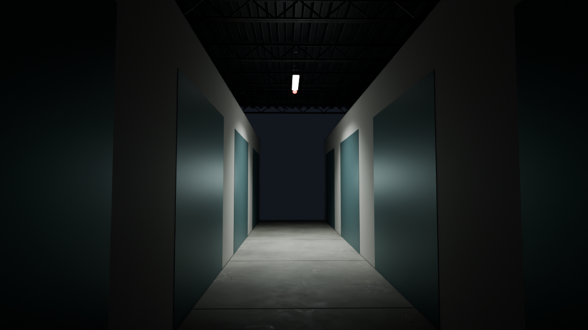
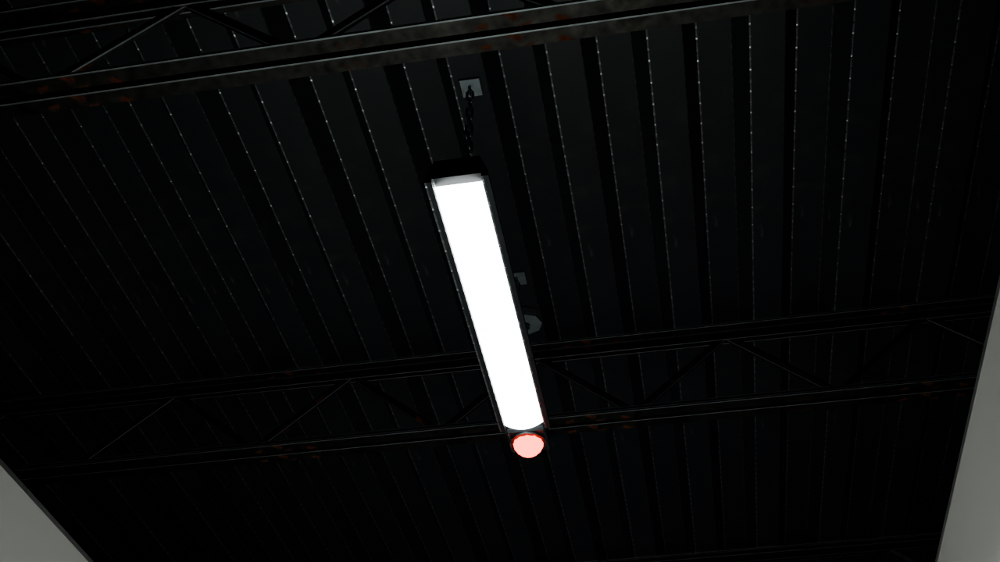

# The corridor kit

The building's hall, as pieces a floor is laid from (the GDD's tile set: straight, corner, T,
cross, dead end). Built from code in Blender 5.2, the way the unit is (`art/unit/README.md`), and
wearing the unit's own baked texture sets, so the kit bakes nothing.

| | |
|---|---|
|  |  |
|  |  |

Sheets in `art/sheets/`: `corridor-hall` (a player's eyes down two pieces), `corridor-ceiling`
(looking up under a light), `corridor-seam` (straight down on the joint between two pieces),
`corridor-fixture-lit` (walking up to a lit fixture, its eye flared) and `corridor-fixture` (a
torch up at a dark one, its eye watching). The units there are plain stand-in boxes; the light a
lit fixture throws is render dressing. In-game shots are in `docs/art/P0-03a-*.jpg` and
`docs/art/P0-03b-phone.jpg`.

## Built so far

**Straight** (P0-03a): 24 studs of hall, the length of two M units a side (three S) and one hall
light's stretch. Two MeshParts:

| Part | Set | Tris | What it is |
|---|---|---|---|
| Floor | Concrete | 12 | the hall's slab between the two rows of door faces, top at 0 |
| Ceiling | TrimSheet | 1700 | a corrugated steel deck (painted strip) over the hall and the units either side, on four open-web steel joists (raw-steel strip) |

A hall of straight pieces draws in two calls: Roblox instances identical meshes.

**Fixture** (P0-03b, D-021): the hall light, the building's eye. A steel strip light hung on two
jack chains from the deck, with an occupancy sensor on one end. Three MeshParts:

| Part | Set | Tris | What it is |
|---|---|---|---|
| Housing | TrimSheet | 1836 | the painted channel and sensor box, galvanized chains, deck clips and junction box, a black rubber cord |
| Diffuser | none | 40 | the frosted lens, bowed down; the game lights it (`HallLight.light`) |
| Eye | none | 118 | the sensor's faceted half-sphere dome; the game colours it (`HallLight.eye`) |

The lens's middle and size are read from the game's `HallLight.Height` and `TubeSize`, so it sits
exactly where the light was tuned. Its frame is on the floor under the lens's middle, the sensor
towards +X. It belongs midway between two joists (every 6 studs from 3 off a piece's middle); it
reaches 2.45 along the hall each way at most, clear of the joists' steel at 2.81.

## Numbers (studs; `spec.py` holds them all)

| | |
|---|---|
| Frame | origin at the middle of the hall floor, on the floor; the hall runs along X |
| Hall | 8 wide, door face to door face |
| Ceiling | 32 across (the hall and a 12-deep row of units each side); deck underside 14, closed top 14.35 |
| Joists | every 6, half a spacing in from each end; lowest steel at 12.8 |
| Floor texture | repeats every 8 with a saw-cut joint on its edge; a piece's UVs start on that edge |
| Fixture | lens middle 12.1 (3.8 by 0.44), housing top 12.38, eye 0.36 across hanging to 11.91, chains 1.5 either side of the middle |

Why these: pieces are a multiple of 8 long, so two pieces meet on a joint and never show a seam,
and a multiple of 6, so the joists keep their beat across pieces. The haze under a lit tube
reaches 12.6 (`HallLight.HazeHeight` 9.6 plus a puff's 3), and low graphics draws a hard line
where a puff cuts into anything, so the joists stop at 12.8. `tests/corridor.spec.luau` holds
those rules against the game's numbers, and the export refuses to build if the haze would reach
the joists.

## Into Studio

1. **Build and upload:** `scripts/art.sh corridor` (under a minute), then
   `lune run scripts/upload_art` (or `upload_art Fixture` for just one). Each piece and the fixture
   is its own FBX, `out/Corridor_<Name>.fbx`, and its own Model asset, recorded in `assets.json`.
   Blender stamps the export time into the FBX, so a rebuild always uploads again (in place, same
   ID).
2. **Insert and prepare** (through Studio's MCP or the command bar), with Rojo synced:
   ```lua
   -- insert_asset(<id from assets.json>) into Workspace, then:
   -- a Clone: in Edit, require keeps the first version it loaded (docs/STUDIO.md)
   local CorridorKit = require(game.ReplicatedStorage.Shared.CorridorKit:Clone())
   local m = workspace.Corridor_Straight -- or Corridor_Fixture, prepared as "Fixture"
   m:FindFirstChildOfClass("PackageLink"):Destroy() -- a plain model, not a package
   -- remove the insert's "Assistant:<guid>" tag too
   CorridorKit.prepare(m, "Straight")
   m:PivotTo(CFrame.identity)
   m.Name = "Straight"; m.Parent = game.ReplicatedStorage.Corridor -- make the folder once
   ```
   Replacing a template: destroy the old one in `ReplicatedStorage.Corridor` first.
   `prepare` finds the piece's frame from its floor's own box (the insert turns it to some angle
   about Y), anchors everything, takes the meshes out of physics and adds box colliders from the
   spec (the floor is Concrete and the ceiling Metal, for footsteps), pivots the model on its
   frame and streams it whole. A fixture gets no colliders (it hangs out of reach); its frame
   comes from the lens's box, and every part stops casting shadows (no light reaches it from
   above).
3. **Save the place.** The templates live in it (D-009). `CorridorKit.place("Straight", cframe,
   parent)` clones a piece into a floor and `CorridorKit.hang(cframe, parent)` a fixture, handing
   back its lens and eye to light; `DevCorridor` lays three pieces and hangs three fixtures.

## How it's made

```
art/corridor/spec.py    every number; writes src/shared/CorridorKit/Specs.luau
art/corridor/pieces.py  the pieces' and the fixture's parts, UV-mapped with the unit's mappers
                        (art/unit/geo.py); chain links and the cord are drawn without twist
art/corridor/build.py   stages: export (FBX + Specs) | renders (look sheets)
```

It imports the unit's `geo`, `bake` (textured materials), `nodes` and `render` helpers, and reads
the unit's baked maps from `art/unit/out/textures/`.

## Next

- **P0-03c The junctions:** corner, T, cross and dead end, and the plain walls a hall has where
  no unit stands (the test hall uses plain blocks for now).
