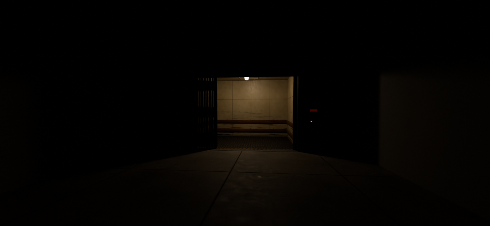
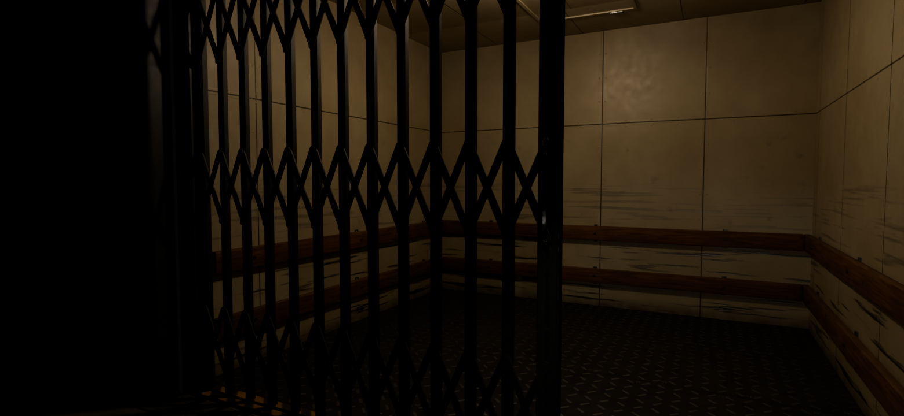
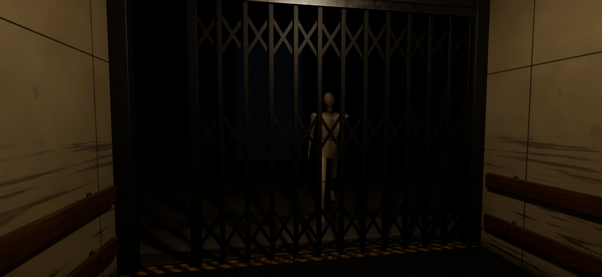
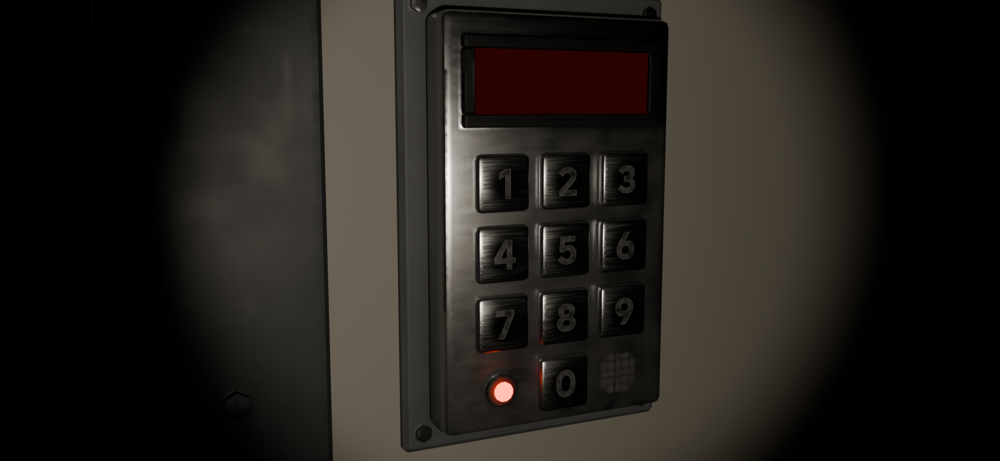
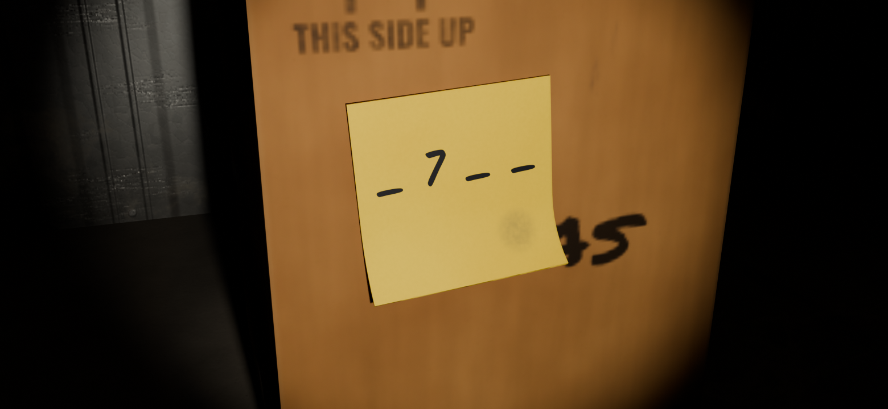

# The freight elevator

The way up (GDD: Codes, the elevator and the roof). Punch the floor's code into the keypad by
the lobby's back wall and the car's folding gate opens; 30 seconds later it folds shut on its own
timer, as Dandy's World's elevator does, and the car goes up with whoever is aboard. Built from
code in Blender 5.2, the unit's way: the car, its gate, the landing's frame, the keypad and the
sticky notes the code is hidden on.

| | |
|---|---|
|  |  |
|  |  |
|  | |

Sheets in `art/sheets/`: `elevator-lobby` (from the hall's mouth across the dark lobby, the gate
folded open: the lit car is the one thing you see), `-shut` (the gate halfway, a stride away, in
a torch), `-aboard` (inside, the gate nearly shut, the Mannequin come to the gate: it can't
ride), `-keypad` (up close in a torch) and `-note` (a note on a box in a unit, by torchlight).

## What it is

- **The car,** 12.5 studs across, 11 deep and 9.6 tall inside: six players stand clear of the
  gate and the Mannequin (6.3) walks under its track. Cream enamel on riveted steel panels,
  scraped through to steel below and between two oak bumper boards where dollies hit, grimy at
  the foot, brown up by the lamp; a diamond-plate floor in plates, worn bright on its lugs; a
  jelly-jar lamp in a wire guard, the warm light you run back to; an escape hatch overhead.
- **The gate,** a collapsible lattice gate, as old freight cars have: 13 steel channel pickets,
  the last the lead with a pull and a rubber edge, and three rows of lazy tongs (72 straps), each
  crossing pair pinned at its middle, its ends riding in the pickets' channels. It folds to the
  left post as you face the car; shutting, its last gap closes at the right post, by the keypad.
  It's one picket, one strap and the lead, cloned and posed by code (`Elevator/Gate.luau`).
- **The landing:** a steel frame filling a 12.4 x 9.2 hole in the lobby's back wall, its jambs'
  feet striped yellow and black, and a grooved aluminium sill. Across a 0.12 gap, the car's own
  sill is striped too: the line you have to be over when the gate shuts.
- **The keypad,** on the lobby wall right of the opening at chest height: brushed steel on a grey
  plate, ten engraved steel keys (1 to 9, 0 alone below), a dark red readout window, a status
  light and a speaker grille. Each key is its own part, so it sinks when pressed.
- **The note,** a big pad's sticky note (0.7 studs, 28 cm), so it can be spotted from a unit's
  doorway: canary paper, its foot curling away, tighter at the right corner, a thumb's smudge.
  Its digits aren't baked. The game writes them in their slots (`_ 7 _ _`) with a SurfaceGui in
  Kalam, Roblox's pen hand, in the flat area `Specs.Note.Write`; the sheets use the same font.

## Numbers

| | |
|---|---|
| Triangles | 9,966 in place (about one storage unit): the gate 4,856 (12 pickets at 96, the lead 248, 72 straps at 48); the note 276 |
| Car | Tiling, 1024², 80 texels a stud: one repeat is 12.8 studs across, a diamond plate 3.2 deep under a wall 9.6 tall |
| Elevator | 1024², 41 texels a stud: the car's front (`CarFront`), boards and hatch (`CarTrim`), the landing's frame (`Portal`) and sill (`LandingSill`) |
| Fittings | 1024², 133 texels a stud: the gate's three parts, the lamp, the keypad, its ten keys, the note |
| Untextured | `LampGlass`, `KeypadReadout`, `KeypadLight`: the game sets their Material and Color |

## How it's made

```
art/elevator/spec.py    every number: the landing, the car, the gate (and gate_pose), the keypad,
                        the note; writes src/shared/Elevator/Specs.luau
art/elevator/build.py   stages labels | textures | export | renders
scripts/art.sh elevator all four (about 4 minutes)
```

- **The car's walls, ceiling and floor tile** across the Car set, as the unit's partitions do.
  Each wall starts somewhere else in the set and one repeat is wider than a wall, so none shows a
  repeat; the floor is laid in plates a plate deep; the ceiling's panels wear a wall's top.
- **The rest borrows the finds' bake** (`art/finds/build.py` as a library), twice. Each part is
  smart-projected alone, then every island of a set is packed together at one shared scale
  (`unwrap`): the kit's square for each part wasted most of the atlas on long strips.
- **Faces nobody sees aren't built** (`cull`): the backs of plates and boards against walls,
  the sill's underside, the posts' outsides. They'd only take texels.
- **The keys' digits** come from a label sheet (`labels`, Builder Sans Bold), engraved into the
  keys by the bake.
- **The sheets** pose the gate with `spec.gate_pose` (what `Gate.luau` does) and stand the
  Mannequin in the game's own poses (`art.sh` runs `lune run scripts/mannequin-poses` first).

## Into Studio (L-05a2)

`lune run scripts/upload_art Elevator`, insert the asset, then prepare it as the Mannequin's
import is prepared: the pivots normalised, colliders built from `Specs.Colliders` (the meshes
don't collide), the gate's 85 parts cloned from its three templates and posed folded, the note
moved to its own template. The template lives in the place (D-009).
