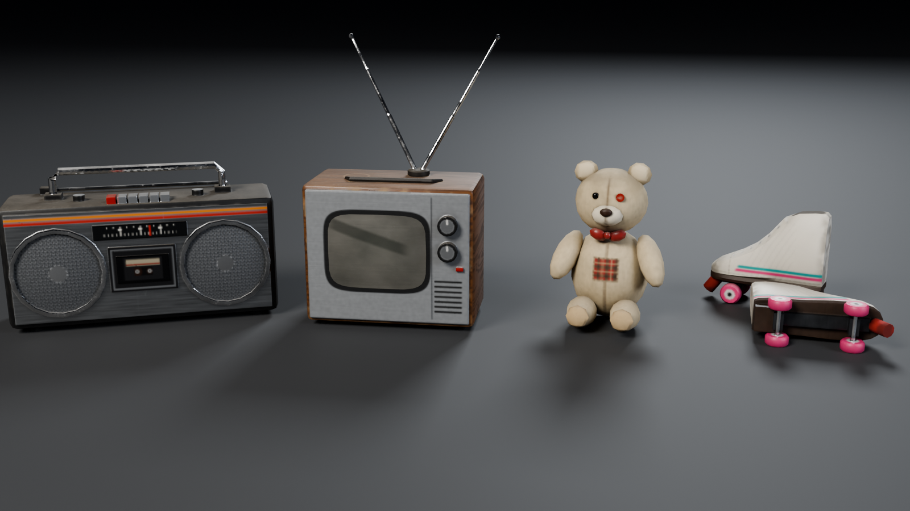
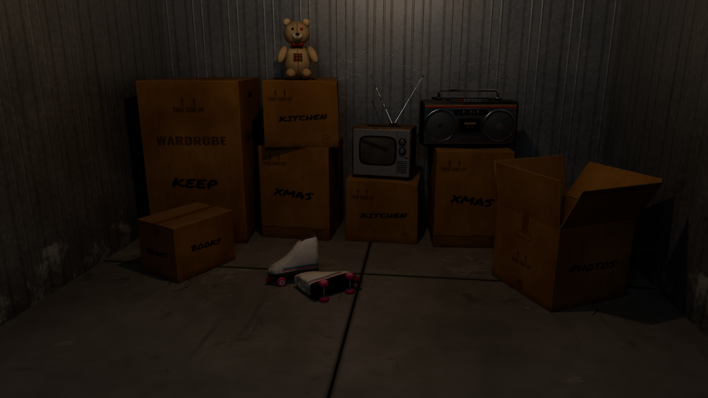
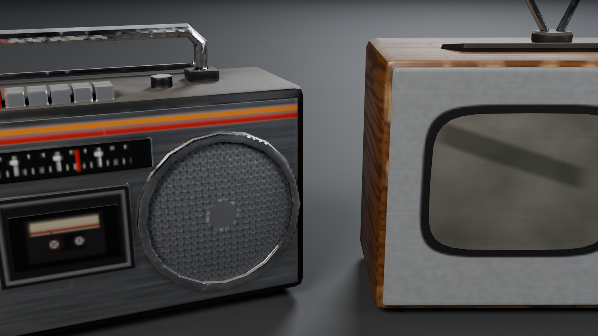
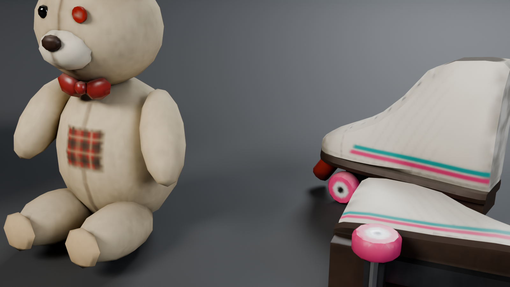

# The finds

What's worth taking out of a unit (GDD "What's behind the door"). Finds come in sets; the 1980s
bedroom is the first: a boombox, a 13-inch portable TV, a teddy bear and a pair of roller skates,
at their real sizes at 10 inches a stud (the boxes' scale). Built from code in Blender 5.2, the
unit's way.

| | |
|---|---|
|  |  |
|  |  |

Sheets in `art/sheets/`: `finds-lineup`, `finds-close-a` and `-b` (in the studio), and
`finds-unit` (among the boxes at the back of a unit, by a dim warm bulb, from the doorway).

## What they are

- **Boombox:** black plastic case, brushed-aluminium front with the red and orange stripes of its
  day, two perforated grilles with chrome dust caps in chrome rings, a tape behind the smoked deck
  window (label, reels, tape wound more on one side), a tuner with a red needle, piano keys (the
  record key red), a chrome handle and an aerial lying along the back. Old chrome: tarnished,
  pitted with rust; scuffed edges, fine scratches.
- **Television:** walnut woodgrain vinyl worn through at the edges, a cup's ring on top, a
  silver-painted front, a grey-green glass bowing out with a film of dust and a finger's smear
  through it, two ridged dials, speaker slots, a red switch, rabbit ears in three telescoping
  sections, the tube's housing behind with vents.
- **Teddy:** cream plush gone grey where it was held, combed and matted, a seam down its front,
  a plaid patch sewn over a hole in its belly, a satin-stitched nose, one bead eye and one red
  button sewn on for the other, a faded red bow.
- **Skates:** a pair of ivory high-tops, creased at the ankle and scuffed at toe and heel, pink and
  teal stripes, laces through chrome eyelets, pink wheels with white hubs, red toe stops; one
  standing behind in profile, one fallen on its side in front with its wheels to the door (side
  by side, the fallen one hid the other's wheels, the skates' tell).

Every find has dust on whatever faces up (`spec.DUST`). A mimic has none (GDD): its clean look is
the same atlas baked with `DUST = 0`, for when the mimic is built.

## Numbers

| Find | Size (X across, Y up, Z front to back) | Triangles | Collides as |
|---|---|---|---|
| Boombox | 2.30 x 1.39 x 0.70 | 1,264 | its box |
| Television | 1.62 x 2.50 x 1.20 (rabbit ears included) | 1,004 | its box |
| Teddy | 1.01 x 1.44 x 0.91 | 1,624 | its hull |
| Skates (the pair) | 1.69 x 0.93 x 1.46 | 2,248 | its hull |

Each find is one MeshPart. Its pivot is the middle of its bottom; its front faces its LookVector.
One texture set, Bedroom (1024², colour, normal, roughness and metalness, for the chrome), holds
the whole set at 99 texels a stud. The game reads the sizes from `src/shared/Finds/Specs.luau`.

## How it's made

```
art/finds/spec.py    every number: sizes, parts, positions, the dust, the pair's placing
art/finds/build.py   stages textures | export | renders; each find's geometry and recipe, the
                     unwrap, the bake, the FBX, the look sheets
```

- **The unwrap:** each find is smart-projected on its own into its own square of the atlas, sized
  by the root of its surface, so all share one density. (Unwrapped together, the teddy's islands
  folded over one another.) The build stops if any two faces share texels.
- **The bake:** with no margin (Blender bakes the finds one after another, and each one's margin
  painted over its neighbours' edges), then a coverage pass says which texels are islands and the
  gutter is padded from each island's own edge. `out/cover.png` is that coverage.
- **The saved unwrap:** smart project packs differently each run, so the textures stage saves
  its UVs (`out/uvs.npz`) and export and renders wear them; every stage prints how many faces sit
  on unpainted texels, a handful of hairline bevel faces at most. A changed mesh needs the
  textures stage again (`scripts/art.sh finds` runs all three).
- **The skates** bake as one skate and ship as a pair wearing the same texels.

It borrows the unit's helpers (`art/unit/bake.py`, `nodes.py`, `geo.py`, `render.py`) and the
boxes' build for the unit look sheet's room and boxes.

## Into Studio

1. `scripts/art.sh finds` (about 80 seconds), then `lune run scripts/upload_art Bedroom` (one
   FBX, one Model asset, its ID in `assets.json`).
2. Insert the asset (the MCP's `insert_asset`), then in the Edit view, with Rojo synced:
   ```lua
   local Finds = require(game.ReplicatedStorage.Shared.Finds)
   local props = game.ReplicatedStorage.Props
   local folder = props:FindFirstChild("Finds") or Instance.new("Folder", props)
   folder.Name = "Finds"
   for _, p in workspace.Bedroom:GetChildren() do
       if p:IsA("MeshPart") then
           Finds.prepare(p, p.Name); p:PivotTo(CFrame.new()); p.Parent = folder
       end
   end
   workspace.Bedroom:Destroy()
   ```
   Remove the `Assistant:` tag `insert_asset` adds. CollisionFidelity takes, though a read in the
   same call still says Default: check it in the next (`docs/STUDIO.md`).
3. Save the place: the templates live in it at `ReplicatedStorage.Props.Finds.<Name>` (D-009).

`Finds.clone(name, pivot, parent)` stands a copy anywhere; L-04d's director will deal them.

## In a unit

Judged in Studio on the Galaxy A16 view (L-04c2, `docs/art/L-04c-finds.jpg`): all four read for
what they are from 101's doorway at Level01 and 21, among the boxes in the back half of the
unit. A find between the bulb and the door shows the doorway its unlit side and reads as a dark
lump, so finds are dealt deeper than the bulb, facing the door (D-036).
