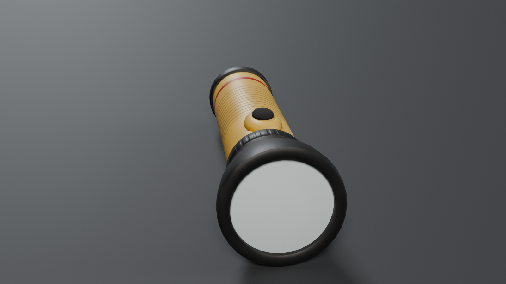
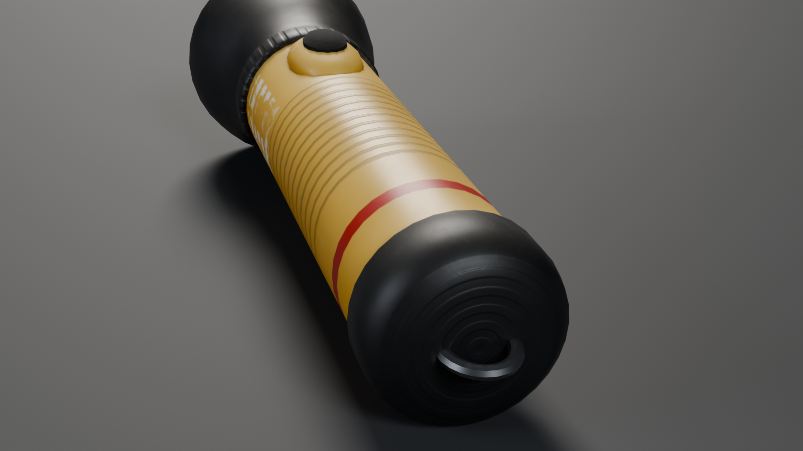
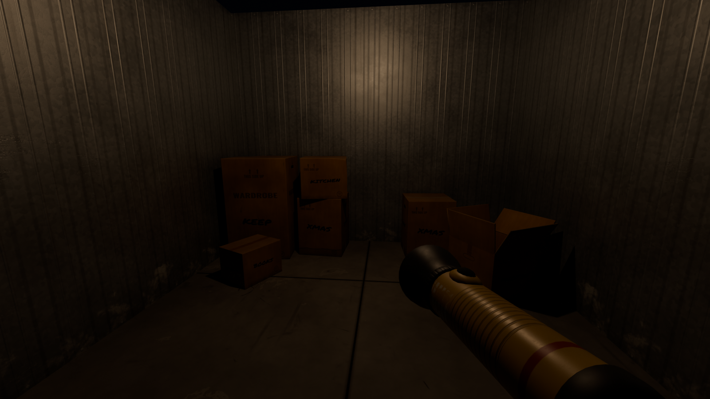
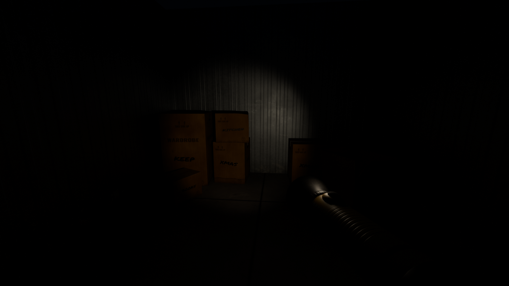

# The flashlight

The torch everyone carries (GDD, the tools table): an old two-battery plastic torch, its tube a
sun-faded yellow with moulded grip rings and a printed red band, a black head flaring out to the
lens, a black rubber button on a raised housing, a black tail cap with rings pressed into its end
and a steel wire bail for a lanyard. Built from code in Blender 5.2, the unit's way, borrowing the
finds' atlas, bake and export (`art/finds/build.py`) as the Mannequin does.

| | |
|---|---|
|  |  |
|  |  |

Sheets in `art/sheets/`: `flashlight-front` and `-back` (lying on the studio floor), `-lit` (its
beam pooling on the floor), `-view` and `-view-off` (your first-person view in a unit, held where
the game holds it, `Torch.Hold`; on in the dark, then off by the unit's bulb). The view sheets'
spill light is a stand-in: the game's is `Torch.SpillOffset` (moved after the sheets were shot).

## Numbers

Sized to a Roblox hand, not to life: 1.34 studs long (a real one would be under a stud and vanish
in an R15 fist), the head 0.43 across, the tube 0.28. Its frame: the lens towards the part's
LookVector, the button up, every point from the grip (where the hand closes round the tube).

| Piece | Size (X, Y, Z) | Triangles | |
|---|---|---|---|
| Flashlight | 0.43 x 0.43 x 1.41 (the bail included) | 2,456 | the Flashlight texture set, 1024², 588 texels a stud |
| FlashlightLens | 0.34 x 0.34 x 0.01 | 224 | plain: the game lights it (Neon on, Glass off) |

The game reads the sizes, the lens's face and the button from `src/shared/Flashlight/Specs.luau`.

## In the place

`ReplicatedStorage.Props.Flashlight` (Rojo can't sync imported meshes, D-009): uploaded by
`lune run scripts/upload_art Flashlight` (asset in `assets.json`), inserted with the MCP, its
PackageLink removed, then `Flashlight.prepare(model)` in Edit: square to the world, the grip at
the origin and every part's pivot, nothing collides, touches, is queried or casts a shadow.

## Rebuild

```
scripts/art.sh flashlight          textures, export, renders (about 2 minutes; the view sheets
                                   need the boxes built)
scripts/art.sh flashlight export   just the FBX and the Specs module
```
