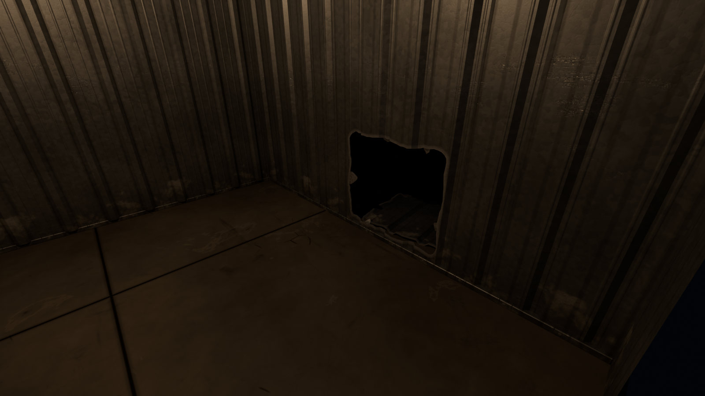
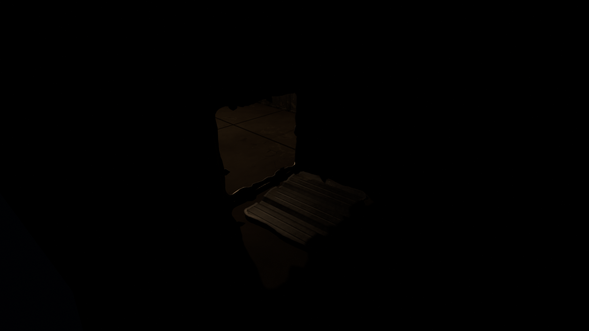
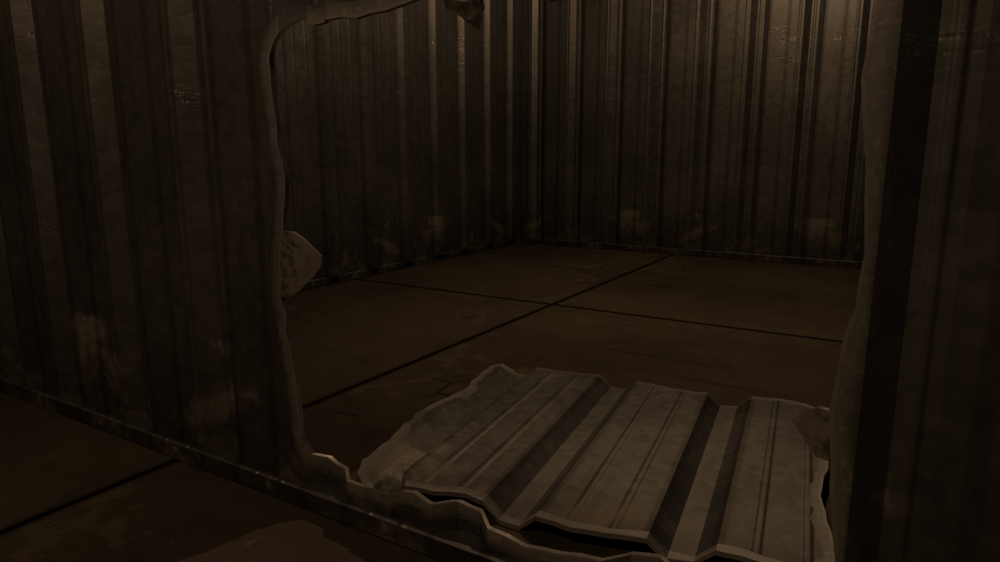
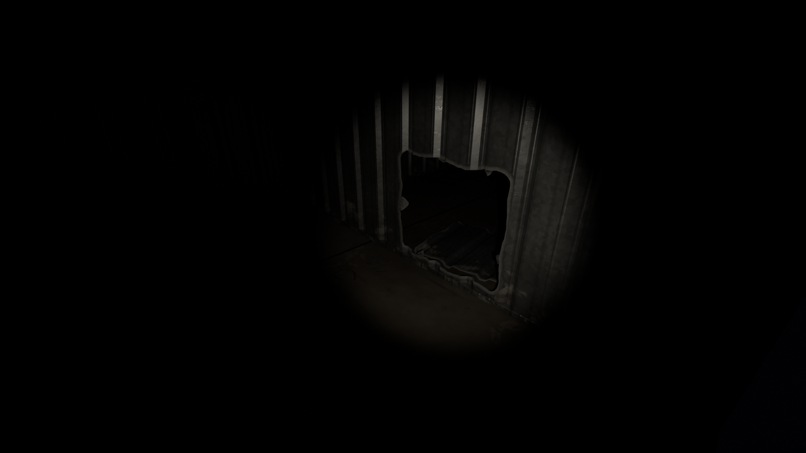

# The crawl hole

What a saw leaves in the wall two units share (GDD "The hole trap"): a low, roughly square hole
in the corrugated steel, its cut wandering where a hand guided the saw and chattering where the
blade jumped, a bright strip of bare steel round it where the saw's shoe scraped the zinc off, a
few tongues of steel left on the cut and bent away from whoever sawed it, and the cut-out panel
lying flat on its ribs on the far side where it fell. From the dark side it's a ragged square of
light with the panel lit in front of it. Built from code in Blender 5.2, the unit's way.

| | |
|---|---|
|  |  |
|  |  |

Sheets in `art/sheets/`: two M units side by side, the hole sawn from the left one (A) into the
right (B). `hole-near` (from A's doorway, B dark), `hole-far` (from B's doorway, B dark and A lit:
the light through the hole), `hole-far-lit` (both lit), `hole-close` (crouched in A),
`hole-torch` (both dark, your torch). In the game: `docs/art/L-12b1-*.jpg` (Studio, Galaxy A16
and a computer).

## Numbers

Where the hole opens and how big it is are the unit's numbers (`art/unit/spec.py`, `crawl_*`):
3.75 to 6.75 studs along the wall from the corridor wall's outer face, 0.3 to 2.9 up. The same
place in every unit, so players learn where to look; it fits whichever neighbour stands the wall,
a stud short of a small unit's back wall. Too low for anyone to walk through and far too low for
a keeper; a player goes through by the "Crawl through" button (L-12b2). The cut's wander, the
strips' widths, the tongues and where the panel lands are in `spec.py` here.

| Part | Set | Triangles | |
|---|---|---|---|
| HoleWall_S_Left, _S_Right | Partition | 558 | a small unit's side wall with the hole, mapped as its WallLeft or WallRight |
| HoleWall_M_Left, _M_Right | Partition | 638 | the same for an M (its plain wall is 336) |
| Edge_Pos, Edge_Neg | Hole | 1,608 | the strips round the cut, its faces, the tongues, the panel's rim and faces |
| Panel_Pos, Panel_Neg | Partition | 286 | the panel where it fell |

"Pos" pieces fall toward the wall's +X (Blender's: its ribs' side), "Neg" are their mirror; the
mirror wears the same texels. A holed M wall costs 2,532 triangles where the plain one cost 336.
The Hole set is one 512² bake, 123 texels a stud (its strips are long and thin, so most of the
atlas is gutter; a phone sees them as a bright line).

## How it's drawn

Every sheet is drawn flat as (along, up) on the wall, filled by a constrained triangulation
(`mathutils.geometry.delaunay_2d_cdt`) with a line at every fold of the corrugation, then stood
out by the sheet's offset at each point. So the wall, the strips and the panel all follow the ribs
exactly wherever the cut crosses them, and the wall stops where the strips start. The strips are
cut at their four corners so they pack as straight strips; the cut's faces are connected rings.
The recipe reads a point attribute `cut`, how far each point is from the cut.

## In the place

`ReplicatedStorage.Props.CrawlHole` (Rojo can't sync imported meshes, D-009): uploaded by
`lune run scripts/upload_art CrawlHole` (asset in `assets.json`), inserted with the MCP, its
`Assistant:` tag removed, then `CrawlHole.prepare(model)` in Edit (it squares every piece to the
kit's frame, since Studio turns an inserted model, and puts the unit's own wall texture from
`ReplicatedStorage.Units.M` on the walls and panel) and moved into `Props`.
`CrawlHole.saw(from, into)` (`src/shared/StorageUnit/CrawlHole`) cuts one in play.

## Rebuild

```
scripts/art.sh hole          textures, export, renders (about a minute; build the unit first)
scripts/art.sh hole export   just the FBX and the Specs module
```
