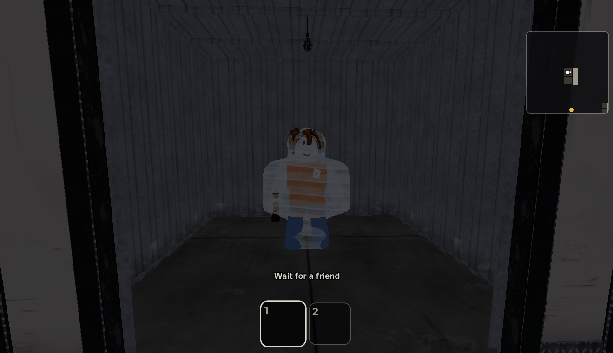
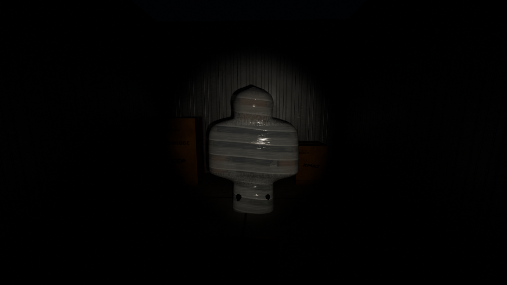
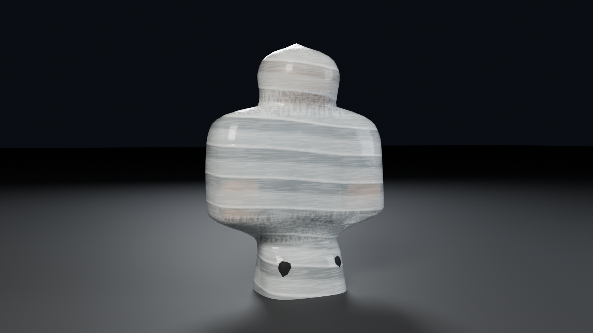
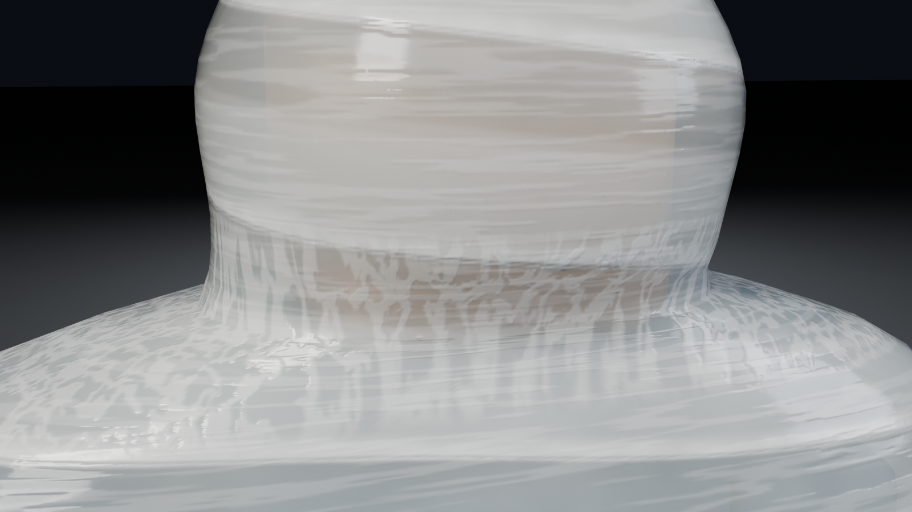

# The wrap a kept player stands in

Caught, you're shrink-wrapped head to foot and stored standing in a shut unit (GDD "Getting
kept"; L-07b). The friend who lifts the door finds you there: a milky cocoon of clear stretch film
wound up you in overlapping bands, your clothes and face blurred inside it, the film gathered and
twisted shut over your head. Built from code in Blender 5.2, the unit's way, borrowing the finds'
recipe kit (`art/finds/build.py`) as the bubble wrap does.

| | |
|---|---|
|  |  |
|  |  |

`keptwrap-studio-door.jpg` is the truth: a Studio capture from the open door of Unit 109 on seed
7, floor 1, with `Lighting.Ambient` raised to 0.35 to see it. The Blender sheets (`-studio`,
`-close`, `-unit`, `-face`, on a blocky stand-in body) draw the film more solid than Roblox
blends it; judge the alpha in Studio.

## Numbers

Drawn round Roblox's default blocky R15 body at rest (arms down), measured in Studio from the
joints' rest offsets: 3.76 wide, 5.19 tall, 1.41 deep. The cocoon is lofted up from the floor
through stations in `spec.py` (the legs bound together, a taut cone from the hands to the thighs,
the arms bound wide at the sides, a pinch at the neck, the head swaddled roomy for hair), 40
points round, a ring every 0.1 studs: 4,440 triangles. The export checks that every body part's
box (pulled in a little, as the meshes are rounder) sits inside the film.

The film: bands 0.95 studs tall, each covering 35% of the last, climbing one band's step a turn so
the spiral meets itself. Alpha (`ALPHA`): one layer 0.46, two 0.68, the edge cords 0.92, the
gathered twist 0.88. One texture set, 1024², UVs laid by hand as one cylinder with its seam down
the back (149 texels a stud), so no stage saves UVs for another.

The game reads the drawn body's box and the wrap's box (both from the root) from
`src/shared/KeptWrap/Specs.luau`, and `Kept.fit` scales the wrap per axis to each kept body's own
rest box (KeptPlayers), clamped to half or two and a half times.

## In the place

`ReplicatedStorage.Props.KeptWrap`: one MeshPart, unanchored, no collision, touch, query or shadow,
massless. Rojo can't sync imported meshes (D-009): uploaded by `lune run scripts/upload_art
KeptWrap` (asset in `assets.json`), inserted with the MCP, its PackageLink and `Assistant:` tag
removed. Its SurfaceAppearance arrives in **AlphaMode Transparency** (the export wires the colour
map's alpha into the material). The server sets each copy's `Transparency` to
`Kept.WrapBlend` (0.02): at 0 Roblox cuts the alpha into hard shreds instead of blending it
(docs/STUDIO.md).

## Rebuild

```
scripts/art.sh keptwrap            the bake, export, renders (about 2 minutes; the unit sheets
                                   need the boxes built)
scripts/art.sh keptwrap export     just the FBX and the Specs module
```

After an upload, re-insert the template: the textures get new IDs.
