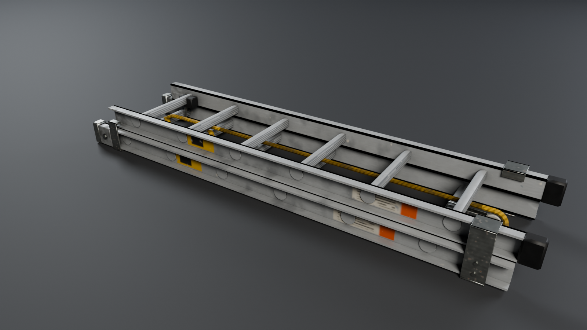
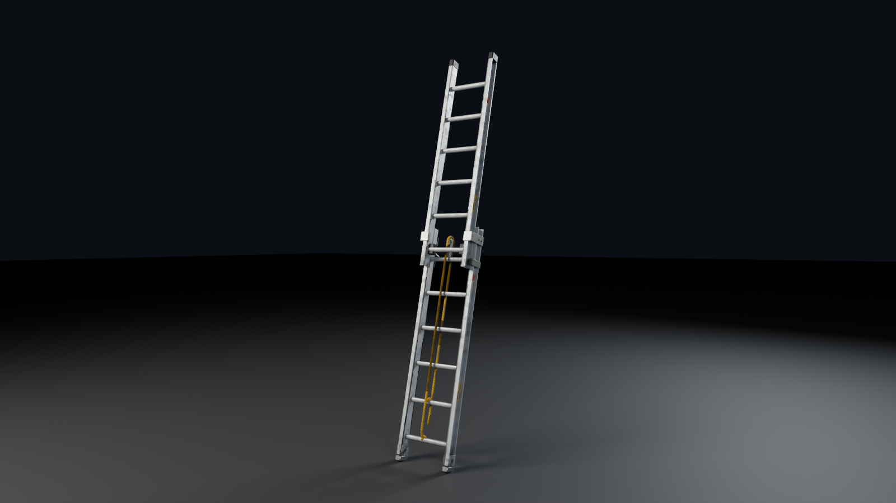
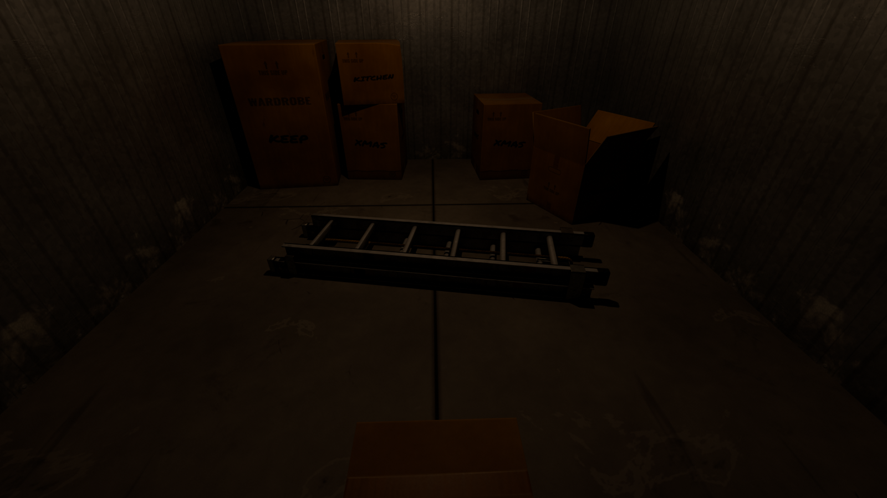
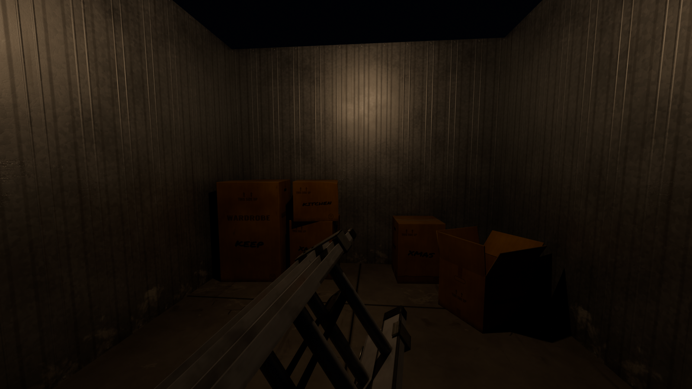

# The ladder

An aluminium extension ladder that has done a lot of jobs (GDD, the tools table: "Gets you onto
open unit tops to run across them"): two sections, the fly riding on the base in guide straps,
black rung locks at the fly's foot, a yellow rope from the base's bottom rung up over a pulley on
its top and back down behind it to a knot, swivel feet with ribbed rubber pads, black caps on the
fly's top, an orange danger label and a yellow duty label on each rail, paint splashes and
scuffs. No brand. Built from code in Blender 5.2, the unit's way, borrowing the finds' atlas, bake
and export (`art/finds/build.py`) as the saw does.

Pale mill-finish aluminium, mostly diffuse: made shiny it took on the dark room's colour and lay
on a unit's floor as a black shape. It reads by its shape, not a colour of its own.

| | |
|---|---|
|  |  |
|  |  |

Sheets in `art/sheets/`: `ladder-front` (collapsed, lying as the game lays it), `-up` (leaned at
75 degrees with the fly run out its full travel: what L-13b2 builds), `-floor` (in a unit by its
bulb, from the doorway at standing height), `-view` (your first-person view at the game's hold,
`Catalog.Ladder.hold`). In the game: `docs/art/L-13b1-*.jpg` (Studio, computer).

## Numbers

Drawn in studs at the building's scale (a stud is about a foot), not enlarged to a hand as the
small tools are: it has to fit the building it climbs. Collapsed it's 6.8 long and 1.74 wide, so
it lies in a small unit (7.2 wide inside) and turns a hall's corner. Its frame: the top towards the
part's LookVector, the fly's face up, every point from the grip (the middle of the base's rail,
a little behind the ladder's middle, where a hand closes to carry it).

| Piece | Size (X, Y, Z) | Triangles | |
|---|---|---|---|
| Ladder (the base) | 1.74 x 0.69 x 6.56 | 4,188 | feet, rails, rungs, top guides, pulley, rope |
| LadderFly | 1.69 x 0.68 x 6.43 | 2,584 | rails, rungs, foot guides, locks, caps |
| | | | one Ladder texture set, 1024², 85 texels a stud |

The fly slides out 5 studs (whole rungs, so its locks land on a base rung): 11.8 studs from the
pads to the caps, which leaned at the 4-to-1 rule reach 11.4 up, a stud and a half past a unit's
wire top (10). The game reads the sizes, the whole collapsed box (`Bounds`), the feet, the top,
the travel and the rungs from `src/shared/Tools/Specs/Ladder.luau`.

Both sections are unwrapped together into the whole atlas (`unwrap` in `build.py`), with a
4-texel pad: the kit's one square per part left half the atlas empty, and its 6-texel pad round
each thin rail face starved the set (44 texels a stud before, 85 after).

## In the place

`ReplicatedStorage.Props.Tools.Ladder` (Rojo can't sync imported meshes, D-009): uploaded by
`lune run scripts/upload_art Ladder` (asset in `assets.json`), inserted with the MCP, its
PackageLink and `Assistant:` tag removed, then `Tools.prepare(model, "Ladder")` in Edit (require a
clone of `Shared.Tools`): square to the world, the grip at the origin and the base's pivot,
nothing colliding, `LadderFly` placed on the base and welded to it (`FlyWeld`, the fly never
anchored), moved into `Props.Tools`.

## Rebuild

```
scripts/art.sh ladder          textures, export, renders (about a minute; the floor and view
                               sheets need the boxes built)
scripts/art.sh ladder export   just the FBX and the Specs module
```
