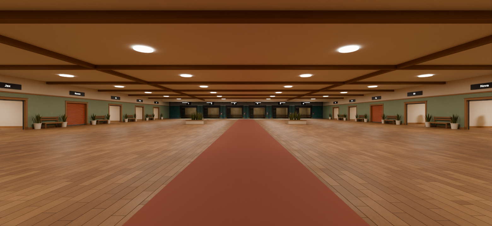
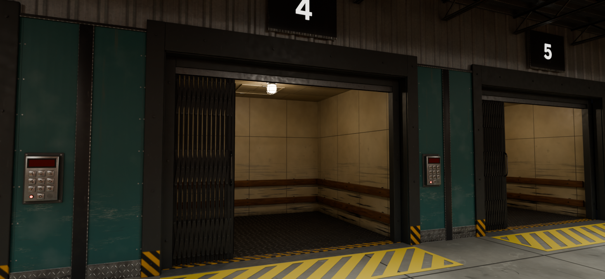
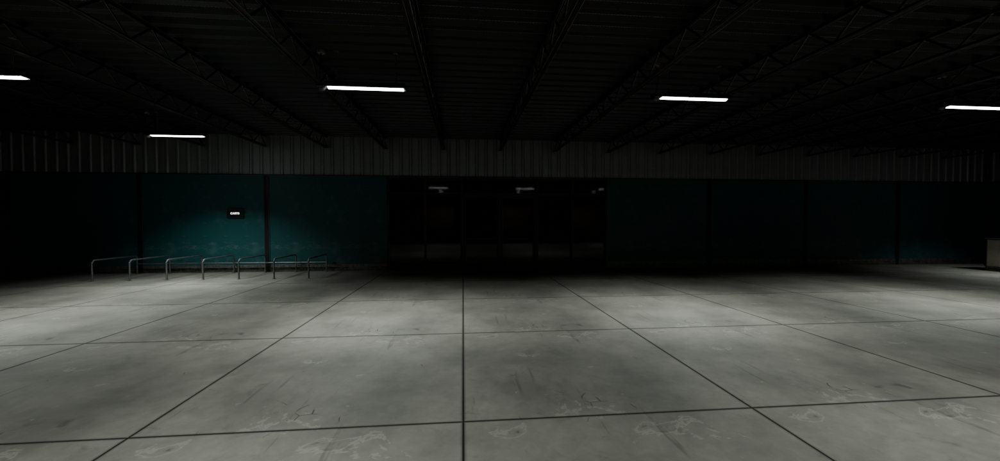
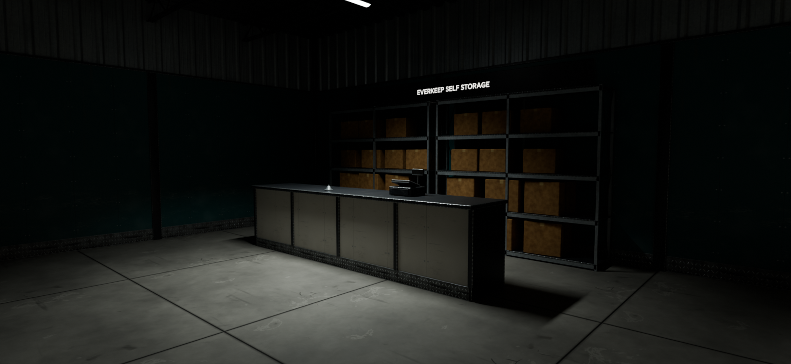
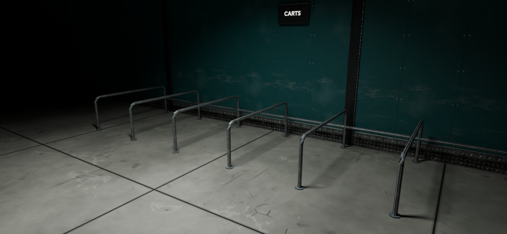
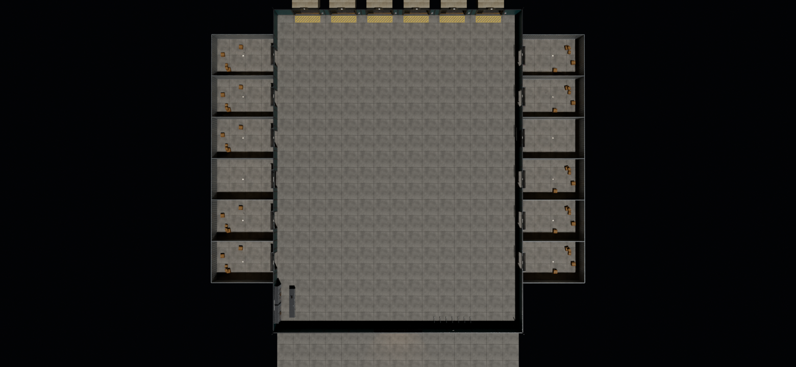

# The front office (the lobby)

Everkeep's front office at night (GDD "The lobby", D-112, D-119). You load in just inside the
glass front door and look straight at six freight cars along the back wall, lit and numbered,
their gates folded open: that is where you go. The counter and the shop's shelves stand to your
left, the cart rack to the right of the door. Built from code in Blender 5.2 the unit's way
(`art/unit/README.md`), but it bakes nothing: every part wears one of the unit's baked texture
sets, and the deck, joists and walls are the corridor kit's own pieces, so the front office is
plainly the same building as the halls.

**Being re-laid as the ground floor** (D-259, D-260): `spec.py` already holds the new numbers
(156 deep, 12 unit slots down the side walls); `build.py`, the sheets and this page still show the
48-deep front office until S5-03a1b.

| | |
|---|---|
|  |  |
|  |  |
|  |  |

Sheets in `art/sheets/`: `lobby-spawn` (where you load in, at a player's eyes), `-bay` (one car
up close: its number, the striped zone, the post between cars), `-door` (from the cars back to the
way in), `-counter`, `-rack` and `-plan` (from above, the deck lifted off). The climb's own car
stands in each bay in the sheets, built by `art/elevator/build.py`; the hall lights are the
corridor's, each lighting the sheet itself, so the front of the room is darker there than in the
game, which lights it with two wide fills. In-game shots: `docs/art/L-08e1a-*.jpg` (the Galaxy A16 and a computer).

## Numbers (studs; `spec.py` holds them all)

| | |
|---|---|
| Frame | the elevator's: origin on the floor at the middle of the bay wall's face, X across (your right facing the cars), the room toward -Y; Roblox: the lobby's LookVector runs from the cars to the door |
| Room | 120 across, 48 from the bay wall to the front, the deck's underside at 14 (the corridor's, so its hall light hangs as tuned) |
| Bays | six, 18 apart (middles at ±9, ±27, ±45); each a 12.4 x 9.2 hole in a 0.5 wall: the climb's landing exactly (the export checks it against `art/elevator/spec.py`) |
| Between cars | 4.2 of wall, a post midway; the car's keypad (8.4 right of its middle) clears the next frame |
| Joists | every 6 across from the middle, spanning front to back, so each car's middle and each hall light falls between two |
| Spawn | 42 from the cars on the middle line, just past the door mat: under 3 s at a run |
| Front | a glass storefront 24 wide round an 8-wide double door, 8 high, transoms to the cap at 9.88; 24 of concrete outside |
| Counter | 14 long, 2.4 deep, its top at 3.4, its face 9 off the left wall; shelves 2 deep against that wall, decks at 0.3 to 8.1 |
| Cart rack | right of the door against the front wall: six slots 3 wide and 4.7 deep for platform carts (L-08e4) |
| Triangles | 25,166 in 13 parts, the deck and joists 10,420 of them (Roblox's cap is 20,000 a part) |

## Parts

Each part is one MeshPart with one texture set (one draw each).

| Part | Set | What it is |
|---|---|---|
| Floor | Concrete | the slab, room and apron outside, joints square to the walls |
| Ceiling | TrimSheet | the corridor's corrugated deck over the whole room on 19 open-web joists |
| Facade | Facade | the painted lower panels on all four walls; the game paints them Everkeep's teal |
| Trim | TrimSheet | posts, diamond kick plates, caps and the four inside corners' columns |
| Panel | Partition | the R-panel from the cap to the deck on every wall |
| Storefront | TrimSheet | the dark steel front: mullions, transom bar, head, the two door leaves with galvanized push bars, the diamond threshold, a rubber mat inside |
| Glass | none | the storefront's panes; the game makes them faint plain plastic (`Lobby.prepare`) |
| Counter | TrimSheet | the steel counter: top with a lip, trim posts, kick plate, the clerk's shelf, a till and a service bell |
| CounterFront | Facade | the counter's painted face; the game paints it cream |
| Shelves | TrimSheet | two steel shelving units, channel uprights, five decks, crossed braces at the ends |
| CartRack | TrimSheet | seven galvanized pipe hoops with flanges and a back rail |
| Signs | TrimSheet | a number plate over each car, Everkeep's name over the shelves, the CARTS plate, on standoffs |
| FloorPaint | none | the yellow border and 45-degree stripes before each car; the game colours it |

What the game adds (`src/shared/Lobby/init.luau`, `Lobby.lay`): the writing on the plates
(`Specs.Cards`: SurfaceGuis in Builder Sans Bold), the boxes on the shelves (`Specs.Stock`, cloned
from the boxes kit), a hall light at each of `Specs.Lights` (glowing, eye shut), two wide fill
lights, a porch light outside over the door, and the climb's car in each bay (`Specs.Bays`).

## Into Studio (L-08e1a)

1. `scripts/art.sh lobby` (export and sheets, about 3 minutes; it needs the unit's textures and
   the elevator's bakes built), then `lune run scripts/upload_art Lobby` (asset 80376262399856 in
   `assets.json`; later uploads update it in place).
2. `insert_asset` it into Workspace, then from the command bar or the MCP:
   ```lua
   local Lobby = require(game.ReplicatedStorage.Shared.Lobby)
   local m = workspace.Lobby
   Lobby.prepare(m) -- squares the parts on the frame, colliders from Specs, plain parts' looks
   m:PivotTo(CFrame.identity)
   m.Parent = game.ReplicatedStorage.Props -- replacing the old Props.Lobby
   ```
   An Edit `execute_luau` keeps the first copy of a module it required: after changing
   `Lobby/init.luau`, check the template took the new values (STUDIO.md).
3. Save the place (Studio's save, never Publish): the template lives only there (D-009).

The server's `FrontOffice` system lays it at `Lobby.Origin` on every server; the test hall's
"Go to the lobby" post (R) takes you there and "Come back" by the lobby's door returns you.

## How it's made

```
art/lobby/spec.py   every number; writes src/shared/Lobby/Specs.luau (loaded as `lobby_spec`:
                    `spec` is the corridor's, which its pieces read)
art/lobby/build.py  stages export | renders; scripts/art.sh lobby runs both
```

- **The walls** are the corridor's (`pieces._facade`, `_panel` and the unit's trim), each built
  in the corridor's wall frame and turned onto its side of the room. The bay wall's facade stops
  at each hole's edge and its trim at the landing frame's plates, so the elevator's frame covers
  the join.
- **The striped zones** are flat polygons: a border and 45-degree stripes clipped to it
  (`clip`, Sutherland-Hodgman), the concrete showing between.
- **The sheets** load the elevator's build as a library (`elevator_kit`, the finds' and
  Mannequin's trick of swapping `spec`), pose its gate open and copy it into each bay with its
  lamp; the stock boxes are render stand-ins where `Specs.Stock` puts the real ones.

## Not verified yet

- The full lighting on a real low-end phone: two fills, the porch light and six car lamps (each
  car's keypad adds a tiny glow), measured only in Studio's Galaxy A16 view (`OWNER.md`).
- The cars are dressing: untagged, so the climb's keypad, gate clock and ride ignore them.
  L-08e1b1 makes them the way into a climb and decides what the keypad beside each becomes.
