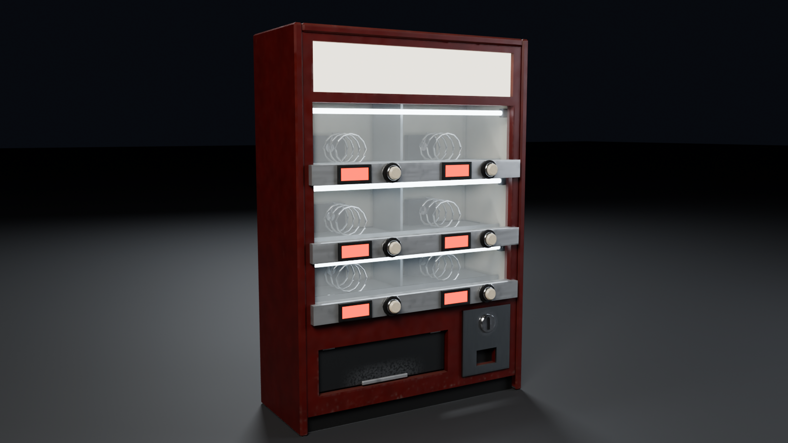
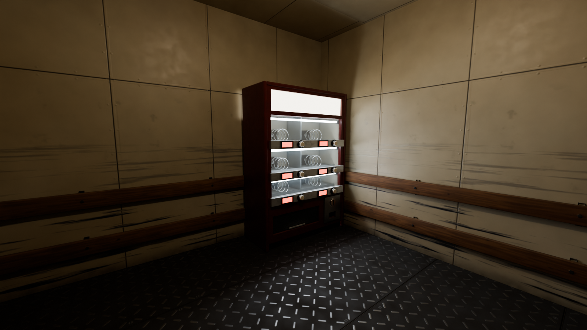

# The machine in the car

The vending machine that rides in every floor's freight car (GDD "The ride"): dark on the first
ride, awake on every later one, selling tools and batteries for coins (S1-10c). A self-storage
supply machine, the kind real storage buildings sell padlocks and tape from: an oxblood enamel
cabinet chipped to grey primer and then to steel on its edges and along its foot, one tall glass
pane over three rows of bays (two battery bays, then two rows of two tool bays), a brushed steel
rail across the glass under each row carrying a red price window and a chunky ivory push button
per bay, a lit sign under the cabinet's cap, and below the glass a push flap over the bin with the
coin plate beside it (a chrome boss with the coin slot, a return cup). Inside: an aged off-white
liner, galvanized shelves stopping short of the glass (the drop to the bin), a divider down each
row, a black motor box at the back of each bay with a chrome coil on its hub. Built from code in
Blender 5.2, the unit's way, borrowing the finds' bake and export (`art/finds/build.py`) as the
battery does.

| | |
|---|---|
|  |  |

Sheets in `art/sheets/`: `machine-studio` (awake, three-quarter), `machine-car` (awake in the
car's back-right corner, from beside the gate at eye height, a phone's 70-degree view),
`machine-dark` (the same, asleep: the first ride, or standing at a floor), `machine-near`
(stepping up to it: the rails, windows and buttons at arm's length).

## Numbers

4.6 wide, 1.8 deep (1.96 with its rails and bezels; 2.4 until S1-10d2), 6.6 tall: the top row of bays is at your
eyes (4.6). Rows bottom up: batteries 1.0 tall, tools 1.25 and 1.25; each bay 1.9 wide. In the
car (`art/elevator/spec.py`'s frame) it stands at x 3.7, y 10.88: its back 0.02 off the back
wall's bumper boards, its right side 0.05 off the right wall's.

Eight MeshParts. Textured, sharing the Machine set at 1024 (about 49 texels a stud; the liner and
shelves at 0.55 of that, since they're seen through glass): `Machine` (the cabinet, door, rails,
bezels, plate, liner, shelves, motor boxes; 1852 triangles, faces against the wall, on the floor
or between panels culled), `MachineCoil` (692, cloned per bay so it can turn about its axis),
`MachineButton` (376, cloned per bay, sinks 0.07 when pressed), `MachineFlap` (176, hung from its
hinge). Untextured, so the game lights them: `MachineGlass`, `MachineTubes` (a fluorescent tube
just behind the glass at the top of each row), `MachinePrices` (the six windows, coplanar, so
one SurfaceGui on its front draws every window's digits), `MachineSign`.

Every number the game needs is in `src/shared/Machine/Specs.luau`, which the export writes: the
size, where it stands in the car, each bay (its middle, its coil's middle, its button's back, its
price window's face), the flap's hinge, the slot, the cup, the sign, the glass, and each part's
box as imported.

## In the place

Uploaded (`assets.json`), loaded in Edit with `InsertService:LoadAsset` and prepared by
`Machine.prepare` into `ReplicatedStorage.Props.Machine` (S1-10b2): the cabinet renamed
`Cabinet`, a coil and a button cloned into every bay, the flap on its hinge, the tubes drawn as
three cylinders at `Specs.Tubes` (the `MachineTubes` mesh is dropped, so each row lights alone),
the sign's emblem and the price windows' frames added. `src/shared/Machine/init.luau` says what
the template holds.

## Rebuild

```
scripts/art.sh machine          textures, export, renders (about 3 minutes; the car sheets
                                need the elevator built)
scripts/art.sh machine export   just the FBX and the Specs module
```
