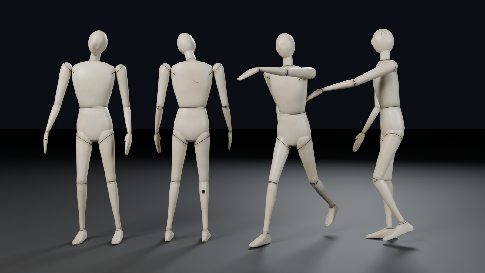
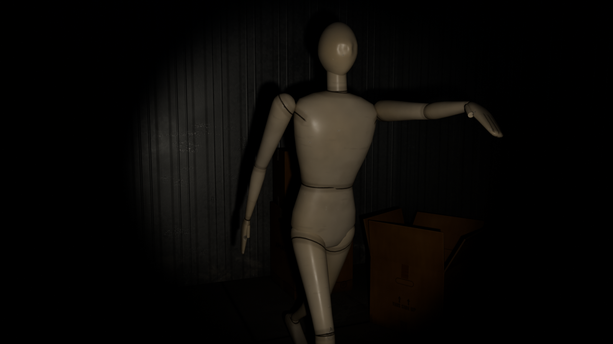
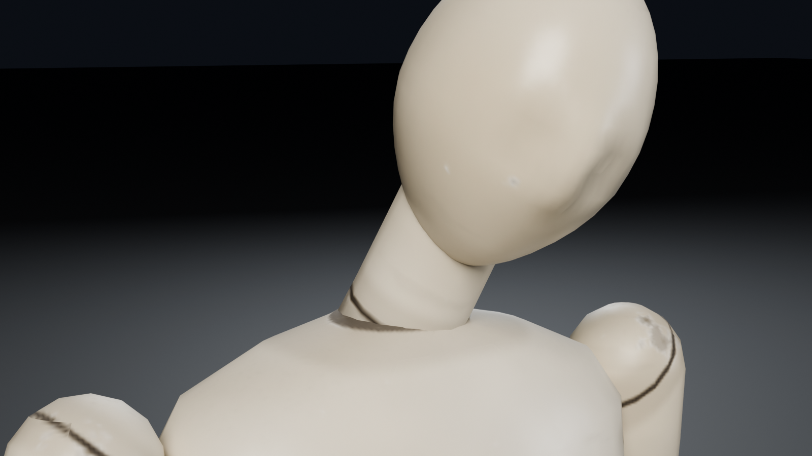
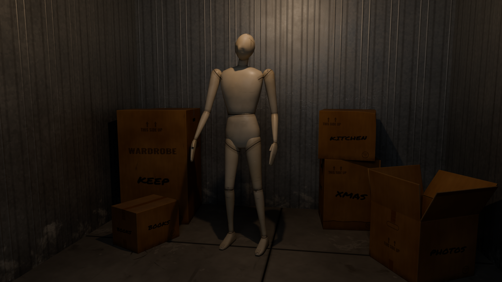

# The Mannequin

The first keeper (GDD Keepers: a Kept Thing). A shop mannequin left too long in storage: faceless
fibreglass, ivory paint yellowed and chipped, cut at every joint. It moves only while no light is
on it, so players remember it by where it stopped and how it stands. Built from code in Blender
5.2, the unit's way, its poses from the game's own `Pose.luau`.

| | |
|---|---|
|  |  |
|  |  |

Sheets in `art/sheets/`: `mannequin-lineup` (as it's found, from behind, mid-step, mid-stride),
`-close` and `-close-b` (the head and the reach, in the studio), `-unit` (standing among the boxes
by a unit's bulb, from the doorway) and `-torch` (the bulb out, a step nearer, reaching, in a
torch from the doorway: the moment the GDD is built round). Studio: `docs/art/L-06a-hall.jpg`.

## What it is

- **6.3 studs tall,** a head taller than a player (about 5.2), so it looms in a doorway. Long
  legs, as a fashion mannequin's.
- **Faceless:** an egg of a head, the skull deeper behind, the jaw narrowing to a chin, only a
  brow and a soft nose ridge and the hollows where eyes would be. A face you can't read.
- **Jointed:** fifteen rigid parts, R15's, each end a dome. At rest each dome sits inside the next
  part; bent, it shows as a ball, so a joint never opens a hole (as an artist's lay figure).
- **Worn:** ivory satin paint yellowed in drifts, matte and grey where hands carried it, grey
  scuffs low down, a dark groove and grime at every seam, chips where it was knocked (the
  shoulders, elbows, knees, knuckles, toes, heels, the nose) through a pale primer edge to grey
  filler and, in the deepest, the glass fibre's weave; a hairline crack over its left temple and
  one across its back; dust on whatever faces up.
- **Where it stood once:** a steel-rimmed socket in the back of its right calf, for a shop
  window's display stand.

## Numbers

| | |
|---|---|
| Height | 6.30 studs (`spec.HEIGHT`) |
| Triangles | 8,356 in all: the head 1,768, the upper torso 780, a hand 496 |
| Texture set | Mannequin, 1024² (colour, normal, roughness, metalness for the stand's steel), 131 texels a stud |
| Parts | 15 MeshParts named as R15's body parts, plus `HumanoidRootPart` (2 x 2 x 1, invisible) |

## How it's made

```
art/mannequin/spec.py    every number: each part's stations, the head, the joints and seams,
                         the capsules the poses are checked against, the soles, the knocks
art/mannequin/build.py   stages textures | export | renders: the parts' geometry, the recipe,
                         the FBX and src/shared/Mannequin/Specs.luau, the look sheets
scripts/mannequin-poses.luau  writes out/poses.json from the game's Pose.luau for the sheets
```

- **Lofted parts:** each part is lofted down through stations (height, half-width, half-depth,
  centre, superellipse power) and domed at both ends; the right side is the left mirrored. The
  foot is lofted heel to toe, flat beneath. The head is built point by point, twice as dense
  round the face, and shaped by a few gentle bumps (brow, nose, chin) and dents (eye hollows).
- **One frame:** every part keeps the figure's origin (the floor between its feet), so the recipe
  paints every part in the same studs: seams are planes through each joint, knocks are points.
- **The bake** is the finds' (`art/finds/build.py`, loaded as a library and pointed at this spec
  and `out/`): each part smart-projected alone into its own square, the unwrap saved and worn by
  later stages, a margin-free bake, a coverage pass, then padding.
- **The sheets wear the game's poses:** `art.sh mannequin` runs `lune run scripts/mannequin-poses`
  before the renders stage, so a pose changed in `Pose.luau` shows in the next sheets.

## Into Studio

1. `scripts/art.sh mannequin` (about 2 minutes), then `lune run scripts/upload_art Mannequin`.
2. Insert the asset (the MCP's `insert_asset`), remove its `Assistant:` tag, and with Rojo synced,
   in the Edit view: `require(game.ReplicatedStorage.Shared.Mannequin:Clone()).prepare(m)` on the
   inserted model, then move it to `ReplicatedStorage.Keepers`. `prepare` adds the root, the
   fifteen RigAttachment pairs and Motor6Ds, and stands it at the origin facing -Z.
3. Save the place: the template lives in it at `ReplicatedStorage.Keepers.Mannequin` (D-009).

`Mannequin.clone(pivot, parent, pose)` stands a copy with its feet on the pivot, posed;
`Mannequin.pose(model, pose)` turns its Motor6Ds (and, in Edit, places the parts).
