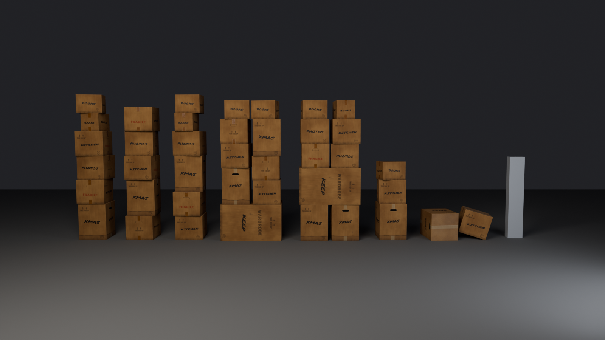
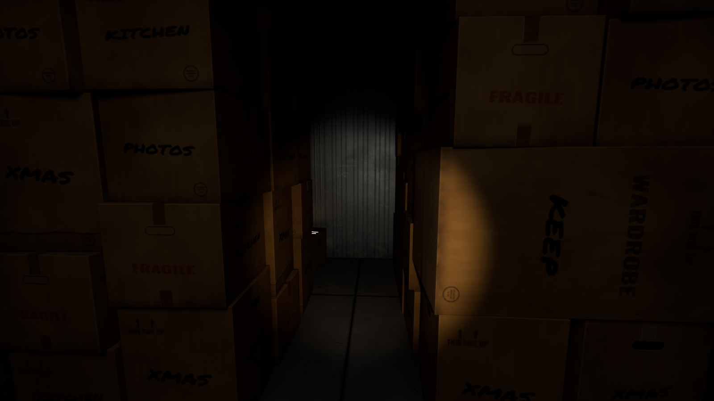
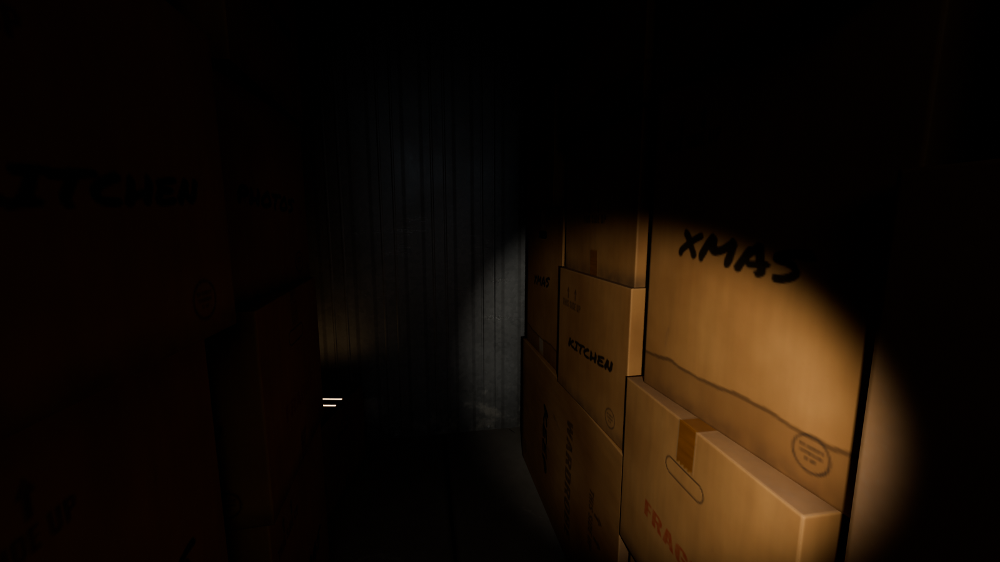
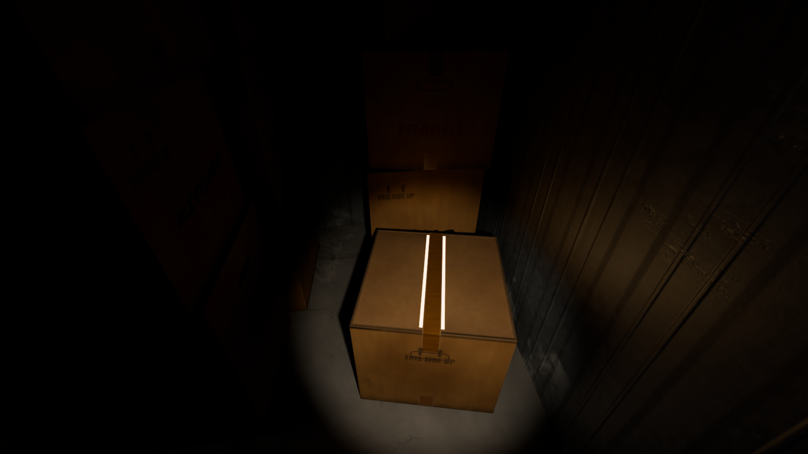

# The packed unit's stacks

The walls of a packed unit (B-05, D-205): moving boxes stacked to the ceiling with one path
through. Seven blocks, each one MeshPart of several boxes from `art/boxes`, built low so a unit
walled with about twenty of them costs about 5,000 triangles (D-215).

| | |
|---|---|
|  |  |
|  |  |

## The blocks

| Block | What it is | Footprint (across x deep) | Tall | Triangles |
|---|---|---|---|---|
| ColumnA, B, C | one box wide, to the ceiling, three mixes | 2.0 x 1.8 | 9.6 / 8.8 / 9.6 | 210 / 176 / 210 |
| WideA, WideB | two wide, on a wardrobe box laid on its side | 4.0 x 2.4 | 9.2 | 320 / 326 |
| Half | a large, a medium, a small set down askew | 2.0 x 1.8 | 5.2 | 108 |
| Toppled | a large on its back, a medium tipped off it | 4.4 x 2.4 | 2.0 | 84 |

A block's pivot is the middle of its footprint on the floor; its front (the side meant to face the
path or the doorway) is its LookVector. Blocks stand side by side at the 2 stud pitch and never
run into each other. `src/shared/Packed/Specs.luau` (generated) gives each block's footprint, its
real reach from the pivot, its height and its triangles.

Every box is cut into 2 x 2 quads a face, bowed out a hair at the middle, one quad where a box sits
on it, none on the floor. Its faces map onto the same islands of the boxes' Cardboard atlas that a
box of its kind wears (the boxes' own packer, run again), so there's no bake here. A medium box
wears either its own sides (KITCHEN, FRAGILE) or the open box's (PHOTOS, UP); larges are few,
since a large says XMAS on both its side and its end.

## Into Studio

1. `scripts/art.sh packed` (export and sheets, under a minute; the boxes' textures must be
   built), then `lune run scripts/upload_art Packed` (asset ID in `assets.json`).
2. Insert the asset (the MCP's `insert_asset`), then in the Edit view, with Rojo synced:
   ```lua
   local Packed = require(game.ReplicatedStorage.Shared.Packed)
   local props = game.ReplicatedStorage.Props
   local folder = props:FindFirstChild("Packed") -- make the Folder the first time
   for _, old in folder:GetChildren() do old.Parent = nil end
   local skin = props.Boxes.Medium:FindFirstChildOfClass("SurfaceAppearance")
   for _, p in workspace.Packed:GetChildren() do
       if p:IsA("MeshPart") then
           Packed.prepare(p, p.Name, skin); p:PivotTo(CFrame.new()); p.Parent = folder
       end
   end
   workspace.Packed:Destroy()
   ```
   The FBX has no texture, so the parts arrive plain; `prepare` gives each a copy of the boxes'
   SurfaceAppearance (re-run it if the boxes are ever re-imported with a new bake).

`Packed.clone(name, pivot, parent)` stands a block anywhere.

## How it's made

```
art/packed/spec.py    the blocks (each box, where, turned how, on what), the pitch, the
                      ceiling, the sheets' sample unit
art/packed/build.py   stages export | renders; loads art/boxes/build.py as a library for the
                      atlas, the material and the unit room
```
