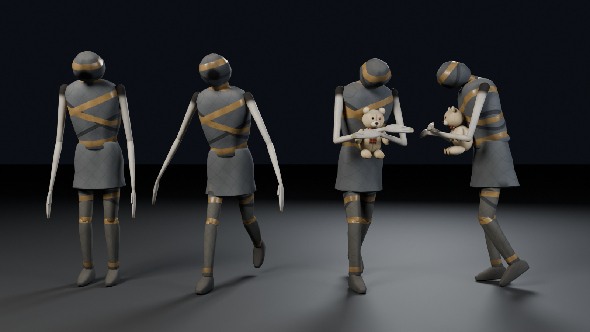

# The Packrat

The second monster (GDD "The Packrat collects things, not people"): a tall, faceless bundle of
grey moving blankets bound with packing tape, two long bare arms out of it. It carries the
floor's finds home one at a time, so its look has one job: full arms read apart from empty arms
from the far end of a hall on a phone. The arms are the only pale thing on it.

| | |
|---|---|
|  |  |

Sheets in `art/sheets/`: `packrat-lineup` (asleep, walking empty, walking full, full from the
side), `-close` (the hug), `-hall` (empty and full 30 studs off, at a phone's size), `-take`
(reaching, taking and putting down, the find in its hands; S2-06a3), `-reach-hall` (the reach
side on from a hall's end, 30 studs off, at a phone's size).

## Numbers

| | |
|---|---|
| Height | 7.3 studs at rest (`spec.HEIGHT`); 8 clears a door |
| Triangles | 7,020 |
| Texture set | Packrat, 1024² (colour, normal, roughness, metalness), 103 texels a stud |
| Parts | 15 MeshParts named as R15's body parts; `prepare` adds the root (S2-06a2) |
| Carry | where a find's middle sits on the UpperTorso, 0.95 ahead, between chest and forearms: `spec.CARRY`, `Specs.Carry` (D-176) |

## How it's made

```
art/packrat/spec.py    every number: the parts' stations, the joints, the tape bands, the
                       quilting, the blankets' edges and greys, the hood's hollow, the capsules
art/packrat/build.py   stages textures | export | renders (scripts/art.sh packrat, about a minute)
scripts/packrat-poses.luau  writes out/poses.json from src/shared/Packrat/Pose.luau
```

The Mannequin's way (`art/mannequin/README.md`): lofted parts in one frame, the finds' bake.
Its own: a blanket part's loft is creased (three waves round and down it) and pulled in where a
tape band crosses it, so the recipe's tape sits in a real pinch; the hood's front is pushed in
and painted near black. The recipe: quilted diamonds puffed between their stitches, a dark
binding where one blanket's edge crosses another, dull tan tape wrinkled across with pale
lifting edges, grime low down; the skin pale and mottled, darker at the elbows and knuckles,
grimed at the fingertips.

## Into Studio

Uploaded with `lune run scripts/upload_art Packrat` (asset 79124901483193, `assets.json`),
inserted, and prepared in Edit by `Packrat.prepare` (`src/shared/Packrat/init.luau`): the
template stands `Still` at `ReplicatedStorage.Keepers.Packrat`. Judged from 30 studs down a lit
hall in Studio, a boombox at the carry point: `docs/art/S2-06a2-packrat-hall.jpg` and
`-close.jpg` (D-176). After a rebuild that changed only the Specs or the sheets, restore
`out/Packrat.fbx` from git: the export rewrites its bytes and it must match the upload.
