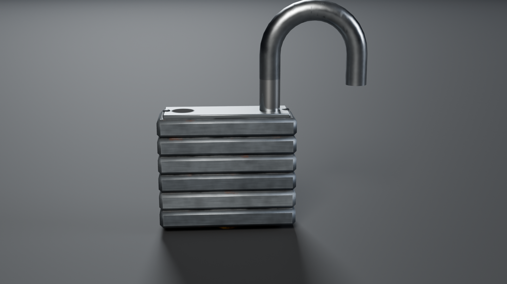
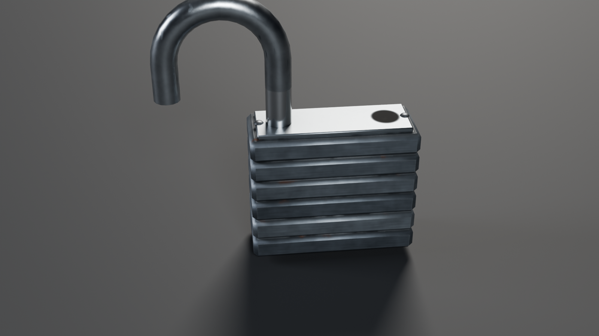
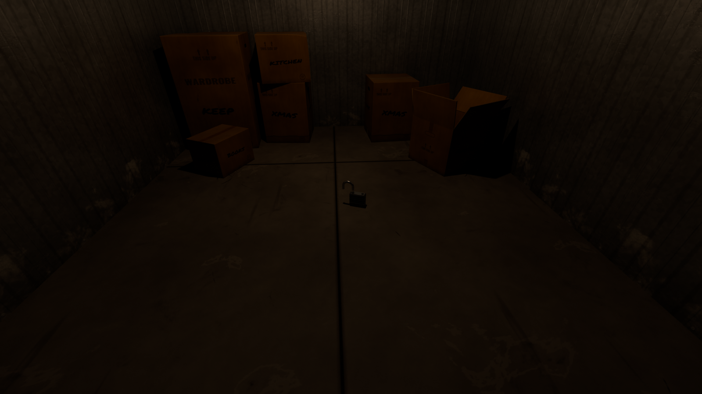
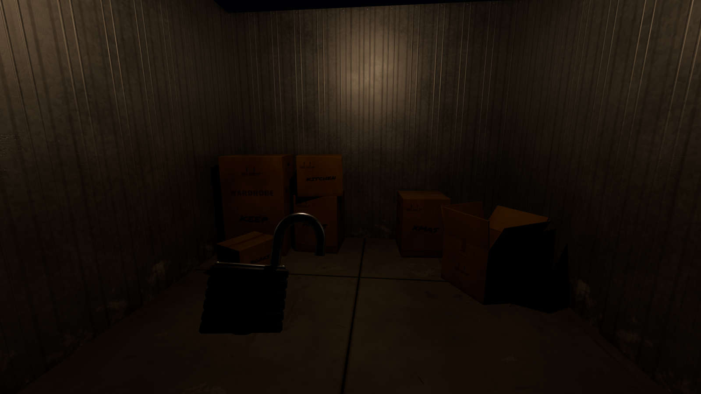

# The padlock you carry

The padlock the building hangs on its doors (`art/unit/parts.py`, `padlock`), in your hand (GDD,
the tools table: "Locks a door so a trapped keeper stays trapped", one per door): six stamped steel
plates stacked and riveted through, each a slightly different grey, their edges worn bright and
grime in the seams with a little rust; a thin cap plate on top with the shackle's hole; a hardened
steel shackle, open, risen and swung out to the side, the stretch that sat in the body clean and
oily; a brass keyway underneath with its key's slot. Built from code in Blender 5.2, the unit's
way, borrowing the finds' atlas, bake and export (`art/finds/build.py`) as the bolt cutters do.

| | |
|---|---|
|  |  |
|  |  |

Sheets in `art/sheets/`: `padlock-front` and `-back` (standing in the studio), `-floor` (on a
unit's floor by its bulb, from the doorway at standing height: the moment you spot it), `-view`
(in your first-person view, about where `Catalog.Padlock.hold` puts it).

## Numbers

Sized to be seen, not to life: twice the doors' padlocks (`S` in `spec.py`), 0.44 studs across
the body and 0.74 tall with the shackle open, so it reads on a unit's floor on a phone. At 1.5
times it was a speck from the doorway. Its frame: the face towards the part's LookVector, the
shackle up, every point from the grip (the body's middle, where the hand closes).

| Piece | Size (X, Y, Z) | Triangles | |
|---|---|---|---|
| Padlock | 0.67 x 0.74 x 0.18 | 1,180 | the Padlock texture set, 1024², 605 texels a stud |

The game reads its size and the shackle's hole from `src/shared/Tools/Specs/Padlock.luau`. On a
door the building's own padlock part shows (the unit's art), not this model.

## In the place

`ReplicatedStorage.Props.Tools.Padlock` (Rojo can't sync imported meshes, D-009): uploaded by
`lune run scripts/upload_art Padlock` (asset in `assets.json`), inserted with the MCP, its
PackageLink and `Assistant:` tag removed, then `Tools.prepare(model, "Padlock")` in Edit. The
command bar caches a required module, so after a catalog change require a clone of
`ReplicatedStorage.Shared.Tools` to prepare (`docs/STUDIO.md`).

## Rebuild

```
scripts/art.sh padlock          textures, export, renders (about a minute; the floor and view
                                sheets need the boxes built)
scripts/art.sh padlock export   just the FBX and the Specs module
```
