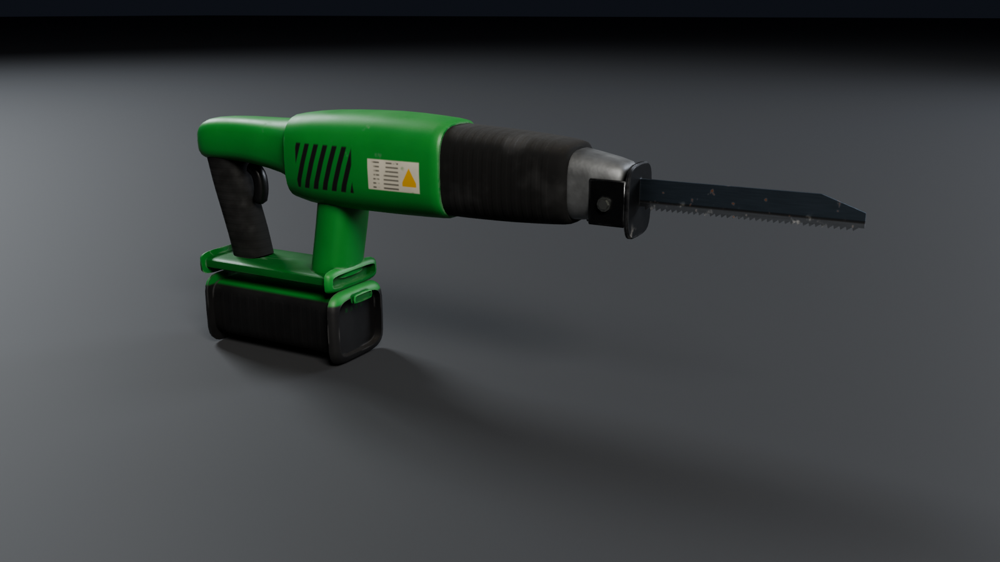
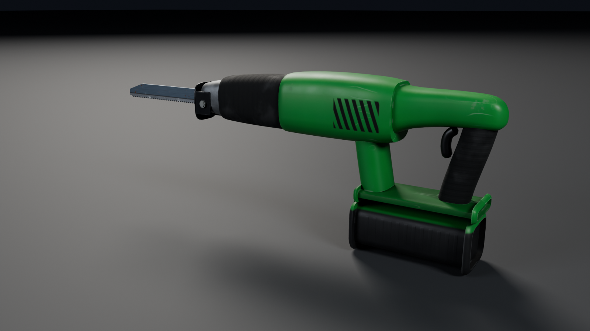
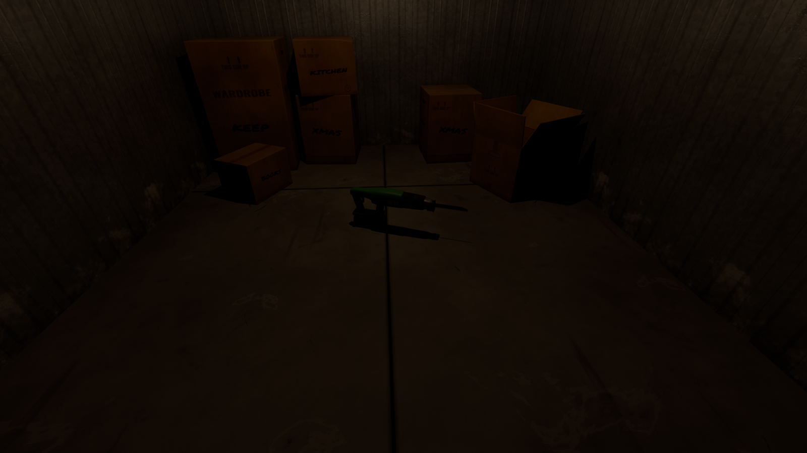
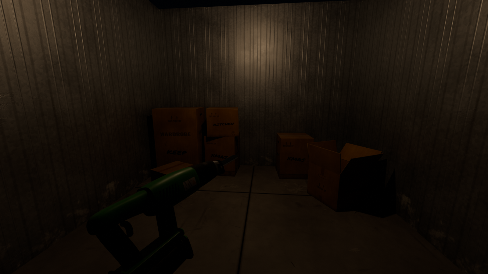

# The saw

A cordless reciprocating saw that has cut its way through a lot of drywall (GDD, the tools table:
"Cuts a crawl hole into the next unit. Keepers can't fit through", and it's loud): a green
plastic body scuffed pale at its corners, slanted cooling slots either side of the motor, a worn
warning sticker on the side your view sees, a black rubber boot over the gearbox where the other
hand goes, a bare cast nose with the blade clamp's lever, a blackened steel shoe, a grey
demolition blade with its teeth ground bright and a film of drywall dust, a rear D-handle with
a black rubber grip and trigger, and a black battery pack under it with a green latch band,
ribbed sides and a charge gauge at the back. No brand. Built from code in Blender 5.2, the
unit's way, borrowing the finds' atlas, bake and export (`art/finds/build.py`) as the bolt
cutters do.

Green because the torch is yellow and the cutters red: three tools nobody mixes up at a glance,
and green stays green under a unit's warm bulb (blue turns grey there).

| | |
|---|---|
|  |  |
|  |  |

Sheets in `art/sheets/`: `saw-front` (your view's side: the sticker, the lever) and `-back`
(standing on the studio floor), `-floor` (standing in a unit by its bulb, from the doorway at
standing height: the moment you spot it), `-view` (in your first-person view at the game's
hold, `Catalog.Saw.hold`). In the game: `docs/art/L-12a-*.jpg` (Studio, Galaxy A16 and computer).

## Numbers

Drawn in a real saw's inches (y from the shoe's face, z from the body's middle line), then
scaled by `IN` (0.12 studs to the inch, about 1.3 times life, as the cutters and the torch are
sized to a Roblox hand). The saw stands on its battery, as the game lays every tool with its
lowest point on the floor. Its frame: the blade towards the part's LookVector, the body up, every
point from the grip (the middle of the rear handle, where the hand closes).

| Piece | Size (X, Y, Z) | Triangles | |
|---|---|---|---|
| Saw | 0.38 x 1.10 x 2.92 | 6,168 | the Saw texture set, 1024², 343 texels a stud |

The game reads its size, the blade's tip and the shoe's face from
`src/shared/Tools/Specs/Saw.luau` (L-12b cuts where the shoe meets a wall).

## In the place

`ReplicatedStorage.Props.Tools.Saw` (Rojo can't sync imported meshes, D-009): uploaded by
`lune run scripts/upload_art Saw` (asset in `assets.json`), inserted with the MCP, its
PackageLink and `Assistant:` tag removed, then `Tools.prepare(model, "Saw")` in Edit: square to
the world, the grip at the origin and the part's pivot, nothing colliding, moved into
`Props.Tools`.

## Rebuild

```
scripts/art.sh saw          textures, export, renders (about 2 minutes; the floor and view
                            sheets need the boxes built)
scripts/art.sh saw export   just the FBX and the Specs module
```
