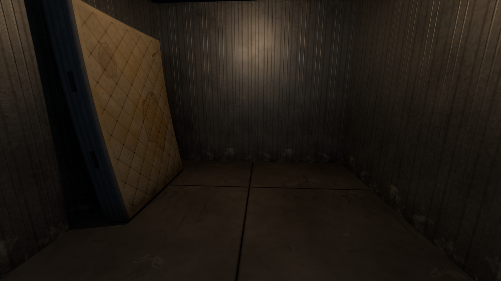
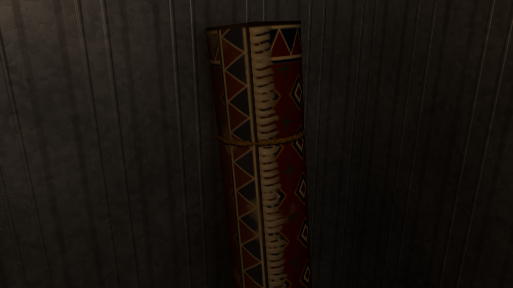
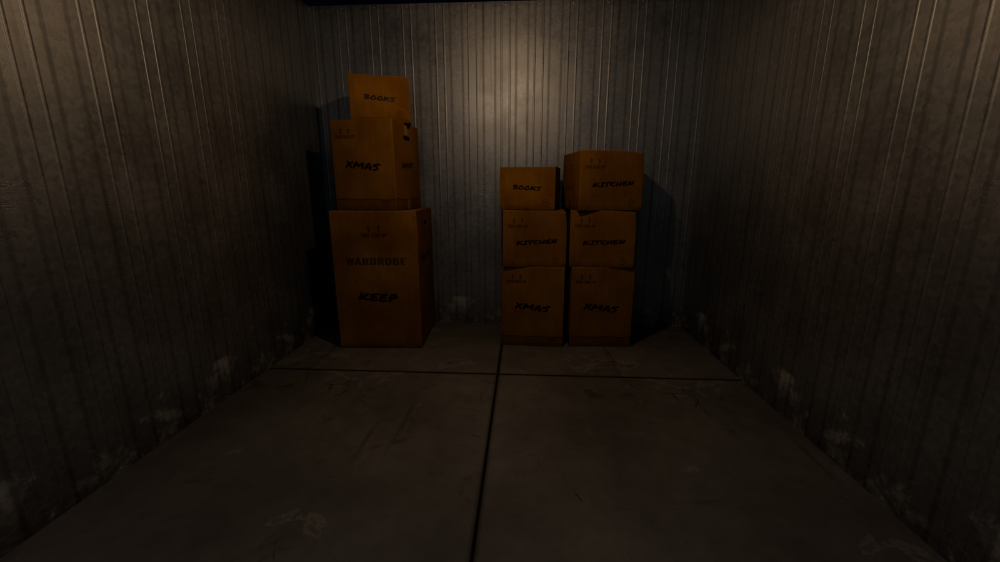
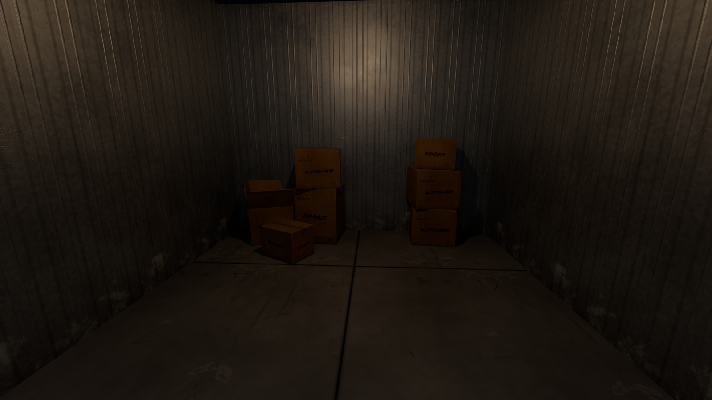

# The stuff in a unit

What some units with nothing to take are full of, so a door going up is never just a bare box
(GDD "Doors": stacked boxes, a mattress, a rolled-up carpet). Two pieces built from code in
Blender 5.2 the unit's way, and four stacks of the moving boxes (`art/boxes`).

| | |
|---|---|
|  |  |
|  |  |

Sheets in `art/sheets/`: `stuff-mattress` and `-near` (against an M unit's left wall from the
doorway, then close), `stuff-carpet` and `-near` (stood in the back corner), `stuff-stacks-a`
(Tower, Wall) and `-b` (Heap, Column). Studio captures: `docs/art/S1-04b1-*.jpg`.

## What they are

- **Mattress:** an old full-size mattress (54 x 75 x 9 inches) stood on its foot end, leaning back
  7 degrees until its top rests on the wall, its middle sagging toward the wall, its top corners
  flopping forward, its foot squashed flat. Ivory ticking quilted in diamonds (a smooth dome in
  each, a tuft where the stitches cross) with a faint grey damask flower, a plain rail inside a
  grey-blue tape edge; a faded blue-grey border quilted in channels with webbing handles and the
  law tag at the foot. Yellowed where it was slept on, a big tide-marked stain and a coffee spill
  on the side facing the room, a split near the top corner showing old foam, grime at the foot.
- **Carpet:** a 5 by 8 foot hand-knotted wool rug, rolled from a short end, tied with two lengths
  of three-strand sisal rope (each knotted), stood on its end leaning 8 degrees into the wall
  (lying on the floor it was a thin line from the doorway). A madder-red field dyed in faint
  bands, navy and ivory diamonds outlined in gold, green crosses between, borders of red and
  navy triangles between guard stripes, threadbare patches; its last end lies on the outside of
  the roll with the fringe flopped over, facing the room; the top shows the wound layers round a
  dark hole.
- **Stacks:** Tower (a wardrobe box, a large, a small: 7.6 tall, nearly to the bulb), Wall (two
  larges, two mediums, a medium and a small), Heap (a large with a medium on it, the open box
  beside, a small on the floor in front), Column (two mediums and a small). Each box is set down
  a little askew; `spec.py` checks every one stands on the floor or square on a closed box below.

## Numbers

| | Size (across, tall, deep) | Triangles |
|---|---|---|
| Mattress | 5.4 x 7.5 x 1.88 | 568 |
| Carpet | 1.06 x 6.02 x 1.95 | 774 |
| Tower / Wall / Heap / Column | 2.6 x 7.6 x 2.6 / 4.0 x 5.6 x 2.2 / 4.6 x 4.0 x 4.4 / 2.0 x 4.4 x 2.0 (flaps and bulge counted, D-136) | the boxes' |

Each piece is one MeshPart, its pivot the middle of its bottom, its front its LookVector, its back
meant for a wall. One texture set, Stuff (1024², colour, normal, roughness, metalness), at 76
texels a stud: both pieces' islands are smart-projected and packed together (the finds' square a
piece left most of the atlas empty around the flat mattress). The mattress and the roll are baked
built straight (upright, lying) so their patterns run true, and posed at export.

## In the place

`ReplicatedStorage.Props.Stuff.Mattress` and `.Carpet` (Rojo can't sync imported meshes, D-009):
`lune run scripts/upload_art Stuff` (asset 116353643690626 in `assets.json`), inserted with the
MCP, the Model's tag removed, each MeshPart through `Stuff.prepare` (anchored, no touch, Box
collision) and moved into the folder. `Stuff.lay(name, pivot, parent)` lays a piece or a stack.

## Rebuild

```
scripts/art.sh stuff          textures, export, renders (about two minutes; the sheets need the
                              boxes built)
scripts/art.sh stuff export   just the FBX and the Specs module
```
