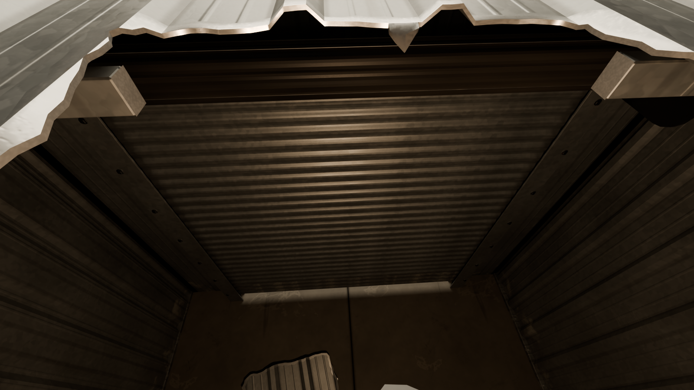
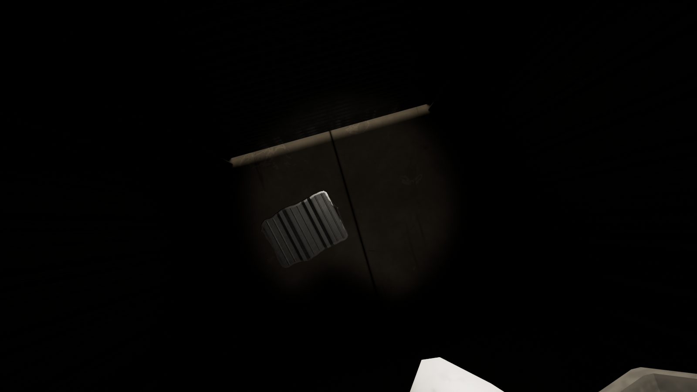
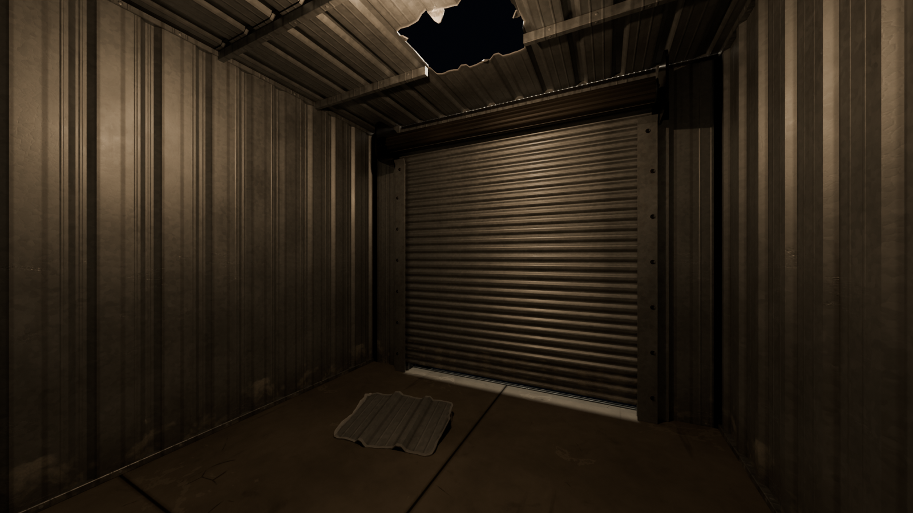
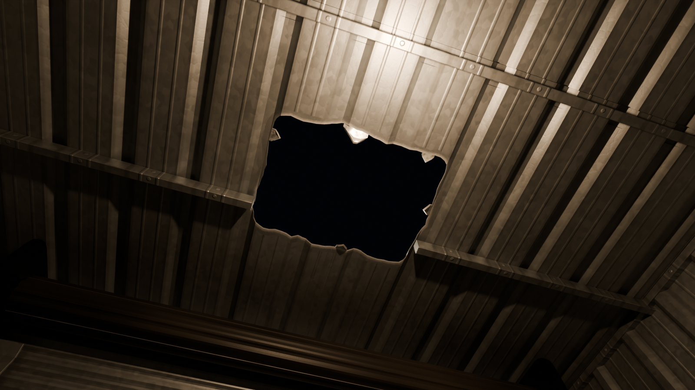

# The sawn top

What a saw leaves in a unit's steel top when someone up on the tops cuts their way down
(L-13b2d, as Rainbow Six Siege's floor hatches): a rounded square in the ribbed steel, big enough
to drop through feet first, its cut wandering and chattering as the wall hole's does, a bright
strip of bare steel round it on both faces, a few tongues of steel bent down into the unit, the
first channel under the sheet sawn through where it crossed, and the cut-out panel lying on the
floor below where it fell, the channel's stub still screwed under it so it lies a little tilted.
Built from code in Blender 5.2, the unit's way, reusing the wall hole's kit (`art/hole/`).

| | |
|---|---|
|  |  |
|  |  |

Sheets in `art/sheets/`: an M unit with its top sawn, a plain M each side. `tophole-down-lit`
(lying at the hole's back edge looking down and ahead, the bulb on), `tophole-down-torch` (your
head out over it looking straight down, the unit dark, your torch: this close the hole fills your
view), `tophole-close` (the cut and tongues), `tophole-inside` (standing at the back: the hole
over the door, the panel on the floor), `tophole-up` (under it), `tophole-along` (lying on the
next top 11 studs off: only a glint of the cut shows, so a lit unit's bulb shining up through it
is what gives a sawn top away). `tophole-s-down` and `tophole-s-inside`: the same hole in a small
unit, its front edge just behind the door's drum.

## Numbers

In `spec.py`. The hole is 2.8 across and 2.05 front to back: a body drops through feet first,
shoulders across, arms up. It sits in the middle of the unit's width, from half a stud in front of
the first of the three channels the top rests on to 1.55 behind it: behind the door's drum (open,
its coil reaches about 1.65 back), on a small unit clear of the two sheets' lap (3.975), with the
bulb hanging behind it from the middle channel. Measured from that channel it is the same in every
size, so one cut edge and one panel serve both; on an M it's a stud further back than on an S, as
its channel is (`Specs.Channel`). Landing under it puts you between the door and the bulb, the
clear part of a unit (D-036 stages finds behind the bulb), facing the room, the door at your back.

| Part | Set | Triangles | |
|---|---|---|---|
| Top_S, Top_M | Partition | 916, 1,156 | the unit's `Top` with the hole cut, mapped as the unit maps it, in the unit's frame |
| Edge | TopHole | 924 | the strips round the cut on both faces, the cut's faces, five tongues, the channel's sawn ends |
| PanelEdge | TopHole | 506 | the fallen panel's rim and cut faces, its stub's sawn ends |
| Panel | Partition | 290 | the panel where it fell, with the channel's stub |

Edge, PanelEdge and Panel are in the hole's frame: the unit's, but measured back from the first
channel's middle (add `Specs.Channel[size]`). The TopHole set is one 512² bake, 139 texels a stud,
from the wall hole's recipe (`hb.look`): the saw's side is the top face, the far side the
underside. Five sliver triangles at the strips' corners (under a texel each) sit on gutter texels;
the gutter is padded from each island's edge, so they wear the strip's colour.

## How it's drawn

The wall hole's build is loaded as a library with this folder's spec (`hole_kit()`), so the flat
drawing, the constrained fill with a line at every fold of the ribs, the strips cut at their
corners, the cut's faces, the atlas packing and the recipe are the same code. The top lays the
sheet flat instead of standing it: (across, back) stood up by the rib's height at each point.
The tongues bend down, the panel is posed by one matrix (`lay`: tilted onto its stub, slid 1.7
across and turned 11°, so whoever drops after it lands mostly beside it).

## In the place

Uploaded Nov 9 (`lune run scripts/upload_art TopHole`, asset in `assets.json`), inserted with the
MCP, then `TopHole.prepare(model)` in Edit: it drops the package link and the `Assistant:` tag,
squares every piece to the kit's frame by `Top_M` (Studio turns an inserted model) and gives the
tops and the panel the unit's own top texture from `ReplicatedStorage.Units.M.Top`. The kit lives
at `ReplicatedStorage.Props.TopHole`; `TopHole.saw(unit)` cuts a unit's top with it (D-062).
After a rebuild: upload, insert, prepare and swap it for the old one there.

## Rebuild

```
scripts/art.sh tophole          textures, export, renders (about 90 s; build the unit first)
scripts/art.sh tophole export   just the FBX and the Specs module
```
