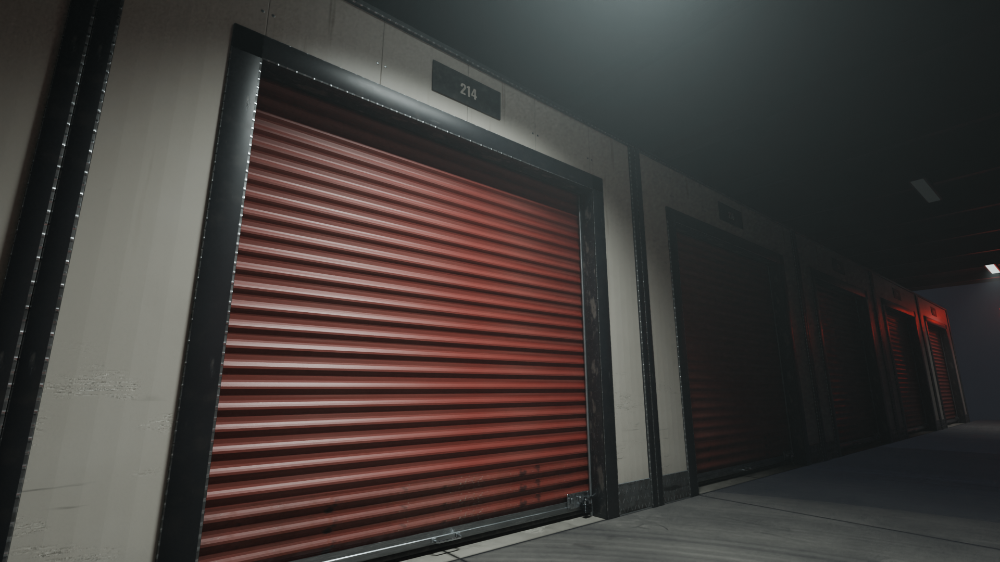
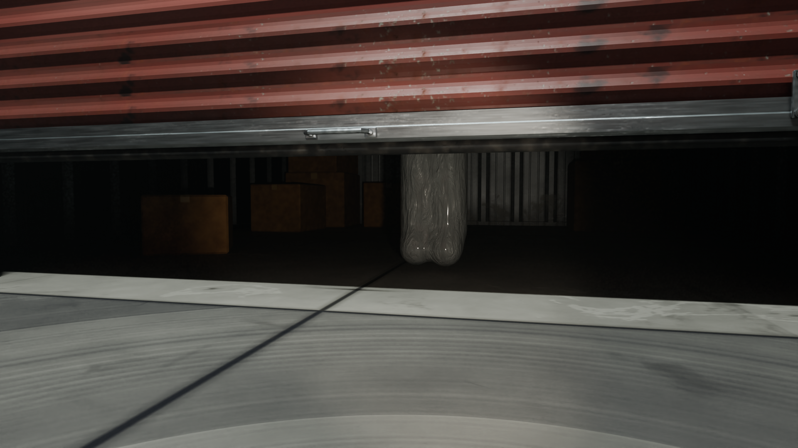
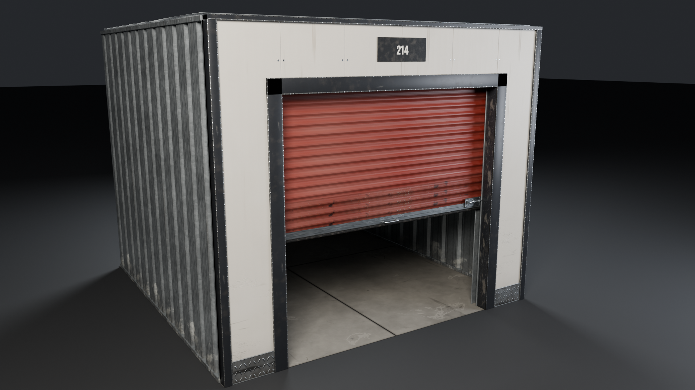
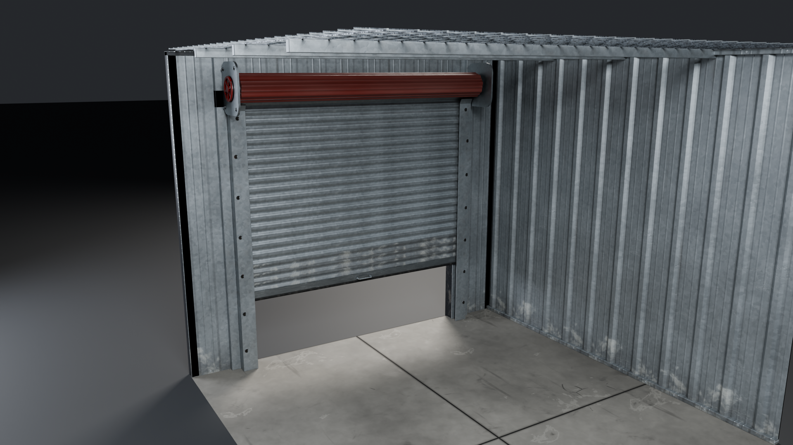

# The storage unit

A 10x10 indoor self-storage unit (size **M**) with a working roll-up door: one number, `rise`,
drives a 38-slat curtain that runs up its guides and winds onto a real coil, the drum turning
with it. Built entirely from code in Blender 5.2 with PBR textures baked from procedural
materials. One texture set paints any door colour.

| | |
|---|---|
|  |  |
|  |  |

Sheets in `art/sheets/` (all at once: `unit-contact-sheet.png`): `unit-hall`, `unit-hero`, `unit-peek` (a foot up, crouched, wrapped
feet behind it), `unit-open`, `unit-inside` (kept, watching the light under the door),
`unit-latch`, `unit-coil`, `unit-tops`, `unit-studio`, `unit-cutaway`, `unit-palette`, and the
motion: `door-hall.mp4` (peek, open, slam) and `door-mechanism.mp4` (the coil winding).
The corridor, lights, boxes and the kept figure are render dressing only.

## Numbers (studs; about 0.28 m each, sized to an R15 avatar)

| | |
|---|---|
| Footprint | 12 x 12 wall centre to wall centre, walls 10 high |
| Doorway | 8 wide x 8 high clear, curtain 0.55 behind the corridor wall's face |
| Curtain | 38 slats, 0.3 stud ribs, 8.64 wide; 1.3 turns on the drum shut, 3.9 open (coil 0.76 to 1.15 across) |
| Rise | Peek 1.15 (the GDD's "a foot"), Open 7.65 (the bar tucks under the header) |
| Light gap | 0.06 under the shut door: the GDD's line of hall light seen from inside |
| Origin | middle of the doorway's outer face, on the floor; the hallway is -Z (LookVector) |

`spec.py` holds every number; S (8x8, 6 wide door) and L (16x20, 12 wide) build from the same
code with `SIZE=S scripts/art.sh geo export`, and `renders` writes their sheets as
`unit-S-<shot>.png` (S's `hall`, `hero`, `peek`, `open` and `studio`; the other shots' cameras sit
for the M). Every size wears the M's bake: a narrower door shows the middle of the slats', bar's
and drum's texture at the M's grain (`Spec.u_across`), and the hardware copies the M's atlas pack
from `out/M/unit.blend` (`bake.copy_atlas`; D-028). S is in the game (L-01b); L is not yet
checked by eye, and its wider door still stretches that texture 1.46x.

## Parts

Each is one MeshPart with one texture set. Moving parts pivot where the rig expects.

| Part | Set | Tris | Notes |
|---|---|---|---|
| Floor | Concrete | 18 | sealed slab; drop it if the level tile has a floor there |
| WallLeft, WallRight, WallBack | Partition | 336 each | R-panel with tracks; `UnitKit.dropWall` the one a neighbour has |
| FacadeBack | Partition | 6 | corridor wall seen from inside |
| Facade | Facade | 10 | corridor wall paint, tinted per floor (Overlay) |
| Frame | TrimSheet | 2020 | jamb and header trim, pilasters, diamond kick plates, guides, posts, stop bolts |
| WireTop | TrimSheet | 696 | the open mesh top you run across (GDD tools: ladder); optional |
| Hardware | DoorKit | 1004 | head plates, axle, the red spring tension wheel |
| Drum | DoorKit | 568 | turns as the curtain winds |
| CurtainClosed | DoorKit | 1520 | the whole shut curtain merged: what a door at rest shows |
| Slat_A, Slat_B, Slat_C | DoorKit | 40 each | templates; C is the grimy bottom three ribs (hidden) |
| BottomBar | DoorKit | 912 | bar, rubber seal, lift handles both sides, latch body and ear |
| LatchBolt | DoorKit | 180 | slides 0.39 into the right guide when locked |
| Padlock | DoorKit | 588 | through both ears; the GDD's bolt-cutter target |
| NumberPlate | DoorKit | 44 | the unit number is a SurfaceGui on its hallway face |
| DoorOrigin | - | 12 | invisible helper: the door's frame |

**Budget:** 8.6k triangles per unit; about 4.8k of it faces the hallway when shut. A shut door
is 16 MeshParts, one of them the merged curtain. Only a door that is moving or open gets its
38-slat chain, cloned on that client from three meshes sharing one SurfaceAppearance, so
Roblox instances them, and dropped again once it's shut. Five texture sets serve every unit
and every size: DoorKit, TrimSheet and Concrete at 1024², Partition and Facade at 512x1024.

## Into Studio

No importer dialog: the FBX goes up through Open Cloud, as porch-pirates ships its art (D-010).

1. **Upload:** `lune run scripts/upload_art` sends each changed `StorageUnit_<Size>.fbx` as a
   Model asset (the first time a new asset, after that the same ID updated in place) and records
   its hash and ID in `art/unit/assets.json`. It needs `.config/.env` (git-ignored) with
   `ROBLOX_API_KEY` (Assets read and write) and `ROBLOX_CREATOR_ID`. Embedded textures arrive as
   SurfaceAppearances, already in AlphaMode Overlay; 1 unit of the FBX is 1 stud.
2. **Insert and prepare** (a session does this through Studio's MCP; the command bar works too),
   with Rojo synced:
   ```lua
   -- insert_asset(<id from assets.json>) into Workspace, then:
   local SU = require(game.ReplicatedStorage.Shared.StorageUnit)
   local m = workspace.StorageUnit_M
   m:FindFirstChildOfClass("PackageLink"):Destroy() -- a plain model, not a package
   SU.UnitKit.prepare(m, "M")
   local outer = SU.RollUpDoor.frame(m) * CFrame.new(0, 0, -SU.Specs.M.CurtainPlane)
   m:PivotTo(outer:ToObjectSpace(m:GetPivot())) -- door face at the origin, looking down -Z
   m.Name = "M"; m.Parent = game.ReplicatedStorage.Units
   ```
   `prepare` stores the rig's calibration on each moving part, anchors everything, adds box
   colliders and the DoorCollider, sets ModelStreamingMode Atomic, tags it `StorageUnit`, and
   forces the tinted SurfaceAppearances to AlphaMode Overlay (the door and facade ColorMaps carry
   alpha: 0 shows the part's Color). If doors ever look see-through, that last step didn't run.
3. **Save the place.** The template lives in it at `ReplicatedStorage.Units.<Size>` (D-009); a
   fresh place gets it back from the asset ID with step 2.

## Moving the door

The server decides; clients render. The GDD's door state machine (range, tool and rate checks)
sits on top of these and is not built yet.

```lua
local SU = require(game.ReplicatedStorage.Shared.StorageUnit)
-- server
SU.RollUpDoor.play(unit, "Peek")       -- 1 s, to 1.15
SU.RollUpDoor.play(unit, "Open")       -- 2 s for a full stroke
SU.RollUpDoor.play(unit, "Slam")       -- lands in 0.28 s, one bounce
SU.RollUpDoor.play(unit, "LiftInside") -- 6 s, heaving
SU.RollUpDoor.play(unit, "Close")      -- 1.6 s
SU.RollUpDoor.setLocked(unit, true)    -- bolt shot, padlock on
SU.RollUpDoor.rise(unit)               -- where it is now
SU.UnitKit.paint(unit, SU.UnitKit.Colours.Door.Teal) -- any Color3
SU.UnitKit.number(unit, "214")
-- client: the DoorView system (src/client/DoorView.luau) calls
local stop = SU.RollUpDoor.watchTagged("StorageUnit")
-- anywhere (cutscene, viewport, Studio preview): pose it directly
local rig = SU.RollUpDoor.rig(unit); rig:pose(3.2, false); rig:destroy()
```

Each move replicates as one string attribute (kind, from, to, server start time). Every client
samples the same curve (`Motion.luau`) and only doors in motion are posed, with one
`BulkMoveTo`. The slat chain is cloned client-side and never replicated. The server moves only
an invisible DoorCollider. A move starts from wherever the door is, so a slam mid-open works.
A padlocked door refuses to lift (`play` returns 0), and `setLocked` only takes on a shut door.
Place and paint a unit before parenting it to Workspace: clients cache its door frame and
clone its colours when it arrives.

## How it's made

```
art/unit/spec.py       every number; writes src/shared/StorageUnit/Specs/<Size>.luau
art/unit/curtain.py    the curtain solver (guides -> tangent -> Archimedean coil)
art/unit/parts.py      the parts, UV-mapped to their texture sets
art/unit/geo.py        mesh helpers; nodes.py a shader-node DSL
art/unit/materials.py  the procedural looks (galvanized spangle and white rust, chipped
                       enamel over primer, rust from chips and rib valleys, kick marks,
                       dolly scuffs at cart height, oily concrete with saw-cut joints)
art/unit/bake.py       Cycles bakes to 8-bit PNG maps (OpenGL normals), atlas unwrap
art/unit/render.py     the look sheets' corridor, lights and dressing
art/unit/build.py      stages: geo | textures | export | renders | anim
scripts/art.sh         rebuild everything (about 15 minutes on an M2 Pro)
```

The Luau rig is a line-for-line port of `curtain.py`; `tests/curtain.spec.luau` checks it
against `tests/fixtures/curtain_M.json` (Python's answers, `python3 art/unit/fixture.py M`).
`scripts/check.sh` runs StyLua, Selene, strict luau-lsp, a Rojo build and the Lune tests.

**Choices.** Rigid ribs hinged at their valleys, not a skinned mesh: a chain of instanced
parts is predictable to pose and cull, and its links never stretch. The GDD's slam, peek and
light gap all fall out of one rise value. Doors and corridor walls are tinted through
Overlay alpha instead of baked per colour, so a floor can repaint its doors for free. Wear
stays on the bottom ribs, crests and valleys, never in a pattern that would repeat every rib.

## Not verified yet

- M and S are in Studio and their doors verified there (P0-02, L-01b; `docs/STUDIO.md`); the
  rest of this list predates that.
- No phone-size screenshot yet (the fight project's bar). Draw calls not measured in Studio.
- The player collides with the server's DoorCollider, which trails the client's picture by
  one-way latency (about 0.1 s): a rising door blocks a moment after it looks open. If that
  feels wrong in play, pose a client-side collider for the local player in the same step.
- No door sounds: `RollUpDoor.play` returns the duration so the door system can time a
  rattle (Open), the bang (Slam) and the quiet peek.
- The crawl-hole wall is its own kit (`art/hole/`, the hole's place in `spec.py`'s `crawl_*`);
  a dented-door variant (trapped keeper) is not modelled.
